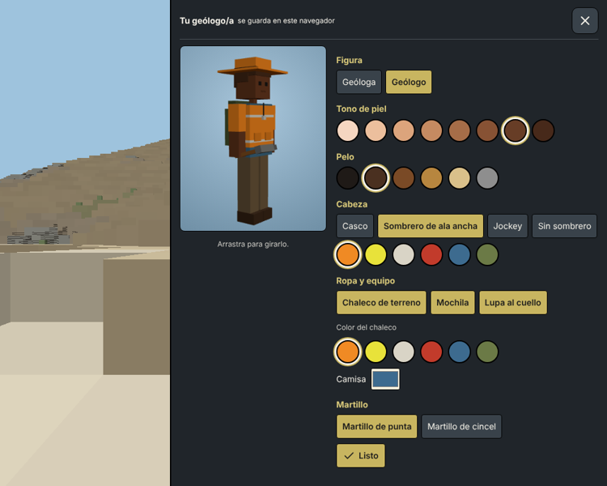
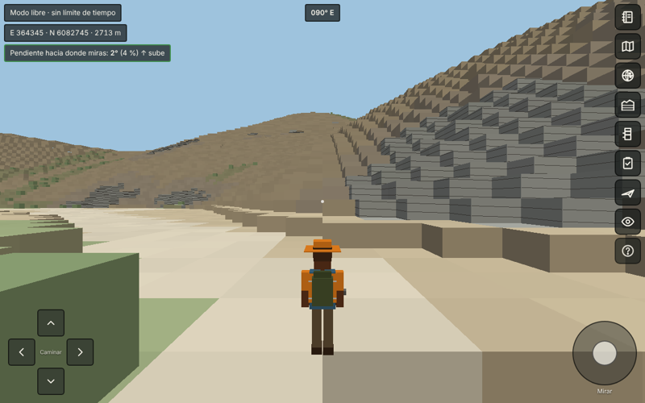

# Tu geólogo/a: characters, skin tone and field gear

## What was built

- **"Tu geólogo/a"**, a screen opened from the start screen and from the pause. On a first visit its button is highlighted. Choices:
  - figure: geóloga or geólogo (the two differ in build and hair; both can wear everything);
  - skin tone: 8 shades;
  - hair: 6 colours;
  - head: helmet, wide-brimmed hat, cap or none, in 6 colours (orange, yellow, white, red, blue, olive);
  - field vest with pockets and reflective stripes, in the same colours;
  - shirt in any colour;
  - backpack;
  - hand lens on a cord round the neck;
  - hammer: pick or chisel.
- **A live preview** of the blocky figure turns slowly; dragging turns it by hand.
- **In the game:**
  - in first person, the arm has the chosen skin and sleeve, and the hand holds the chosen hammer;
  - **third-person view** with V or the eye button: the camera stands behind and a little above, the figure walks with swinging arms and legs, and swings the hammer at outcrops (the chips fly from in front of the figure);
  - the camera never goes below the ground.
- **Saved in the browser** (`geomapper:avatar`, and `geomapper:view` for the view), for every scenario. The choices are not part of an attempt and do not travel with exported notebooks.

## Checks

- Unit tests (`tests/avatar.test.ts`):
  - saved choices are read back, and invalid ones fall back to the default;
  - the chosen skin tone is on the figure;
  - gear adds parts, and the helmet stands above the hair;
  - the figure is about 1.85 m tall;
  - the two figures differ in shoulders and hair.
- `e2e/touch.mjs`, on a phone held upright and sideways and on a tablet:
  - a figure, a skin tone and a hat are chosen with taps and saved;
  - closing returns to the start screen;
  - the eye button switches to third person.
  44 checks pass.
- The other two walks pass (`walk.mjs` 61, `kinematics.mjs` 8), and so do the 93 unit tests.
- The e2e scripts now answer the visit counter's script with an empty file, so a test run is not counted and a blocked network is not a page error.

## Choices made here

- **Figures differ only in build and hair.** Every piece of gear is open to both, and nothing about skill or role changes.
- **The figure is in the scale of the block world**, with its eyes at the eye height of the first-person camera, 3.2 m. That makes it 1.75 times a person, like the blocks themselves.
- **No name** is asked for: the student's name goes on the PDF by hand, and a name will come with sign-in in work package 9.

## Left open

- The figure is not on the map, the PDF or the evaluation.
- There are no other students' figures: that needs the server of work package 9.
- There is no face or hair beyond these choices, and no glasses, gloves or field book in the hand.
