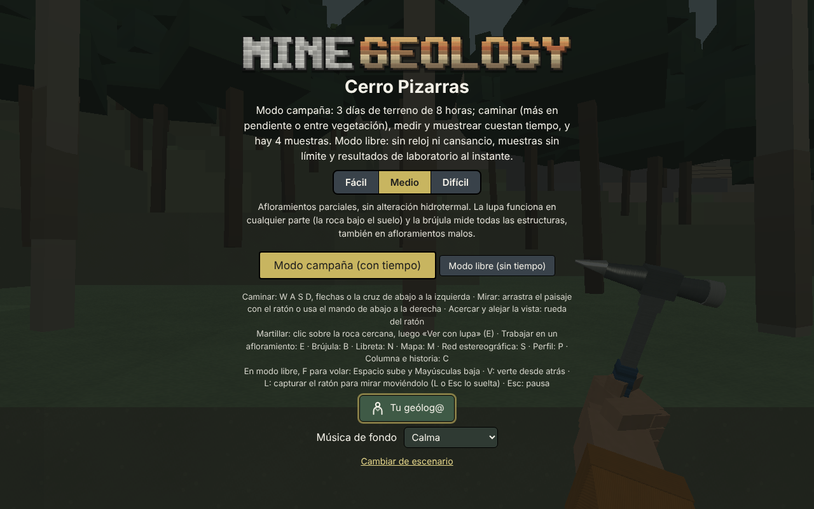
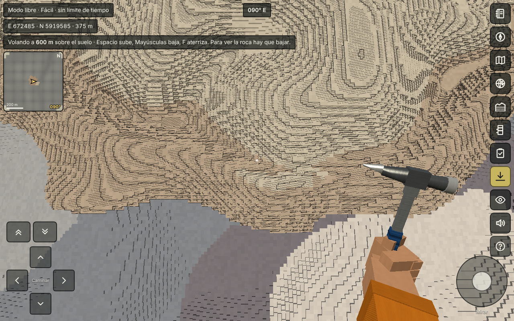
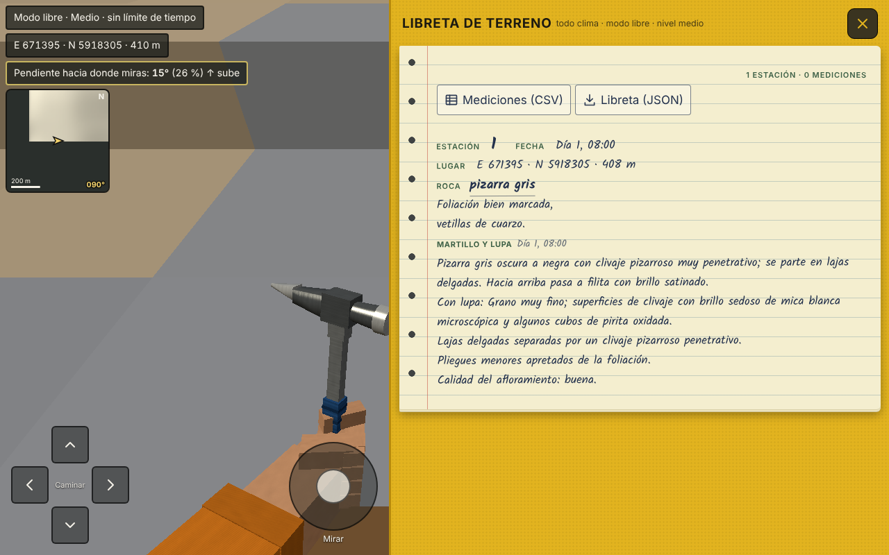

# Three levels per scenario, and a notebook written by hand

## Levels of difficulty

Each scenario can now be played at three levels. The level is chosen on the start screen, with the mode (campaign or free), and is saved with the attempt. The geology of the scenario never changes; what changes is how much of it shows and what the tools allow.

| Level | What the student gets |
| --- | --- |
| **Fácil** | No soil, gravel or vegetation: bare rock of the true unit everywhere, so the hammer, the lens and the compass work anywhere. The solution map and the solution section can be looked at, in a campaign too, and the sense of slip is checked. No hydrothermal alteration. |
| **Medio** | The outcrops as baked, partly covered, without the alteration. The lens works on any ground: hammering soil or vegetation shows the rock underneath (from the true map), in part. The compass goes on every structure of every outcrop, poor ones included: lineations, way-up criteria, contacts and kinematic indicators no longer need a good outcrop. |
| **Difícil** | The scenario as it was: partial outcrops of varying quality, and the alteration mapping where there is one (Cerro Amarillo). |

How it works (`game/src/state/difficulty.ts`):

- The level is applied to the scenario on load, before the world is built (`applyDifficulty`). The rest of the game reads an ordinary scenario, so no tool needed a special case.
- **Medio** drops `alterations`, each outcrop's `observation.alteration` and its vein planes, and raises poor outcrops to fair. The answer key loses its alteration too (`truthFor`), so the solution map has no alteration layer.
- **Fácil** also makes every covered cell bare rock. The cells no real outcrop holds are grouped in outcrops of 4 × 4 cells per unit, with the unit of the true map. Each takes the bedding, foliation, cleavage or joints of the nearest real outcrop of the same unit within 300 m, and, on a fault trace or in the fault zone, the fault plane of the nearest real outcrop that has one. Between 79 % (Cerro Pizarras, where the granodiorite has few planes) and 98 % of these outcrops have something to measure; there are about 3 500 to 4 400 of them per scenario. Fácil needs the answer key, so it is offered only in practice mode.
- Another level is another world. Choosing a different level when starting over reloads the page with `?d=<level>&nuevo=<mode>`, which starts the new attempt and is then removed from the address, so a reload continues it. The level last chosen is remembered in the browser (`geomapper:difficulty`); `?d=facil|medio|dificil` also chooses it for a first attempt.
- Saves from before the levels load as Difícil, which is how they were played.
- The status line shows the level next to the mode or the day.

## The notebook as an all-weather field book

The notebook (N) now looks like a waterproof field book: a yellow cover, cream pages with faint blue rules, a red margin and the holes of the binding. Printed labels (Estación, Fecha, Lugar, Roca) are in small green capitals, and everything the student wrote is in a hand-written letter (Kalam, from Google Fonts; a system cursive when offline), in ink. The station's notebook fields in the field panel (rock name, map unit, notes, sketch) are written straight on such a page, and the sketch pad has the faint grid of a field-book page.

## Checks

- Unit tests (`game/tests/difficulty.test.ts`, 4): Difícil leaves the scenario untouched; Medio removes the alteration and poor outcrops without changing the baked scenario; Fácil lays the true unit over every cell of a forest scenario, with unique ids and most outcrops measurable; the level is saved, and old saves load as Difícil. 115 tests pass.
- In the browser, `e2e/difficulty.mjs` (20 checks): the three levels on the start screen, Medio in a forest with the lens under the soil, the hand-written station and notebook, starting over at Fácil (reload, «Comenzar», bare rock everywhere, the solution map in a campaign) and continuing it after a reload.
- The other walks run at Difícil (they set the remembered level first) and pass: `walk.mjs`, `compass-section.mjs`, `kinematics.mjs`, `notebook-gyro.mjs`, `aim.mjs`, `touch.mjs`. The start screen now scrolls when it is taller than a phone held sideways.

## Left open

- At Fácil the made outcrops have no way-up criteria, contacts or kinematic indicators of their own, and dykes show only where a real outcrop has them.
- At Fácil the minimap shows nearly all of the area as sighted outcrops (grey) until they are visited.
- The structures copied at Fácil come from the nearest outcrop of the same unit; in tight folds they can differ from the true bedding at that spot.
