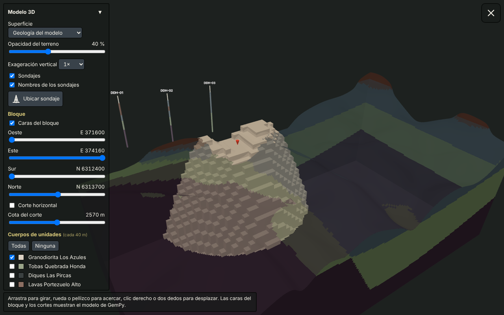
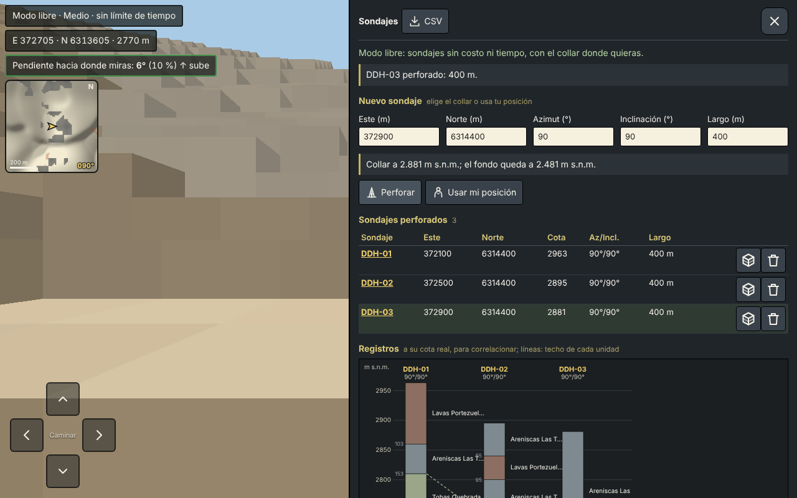

# Drill holes and the 3D model

Two new screens, both reached from the toolbar.

## Sondajes (K)

A hole is a straight line from a collar on the ground, with an azimuth, an inclination below the horizontal (45° to 90°) and a length (20 to 600 m). It is logged against the lithology block that GemPy baked (`litho.bin`, shipped in practice mode as `practice-litho.bin`): every metre takes the unit of the cell it falls in, and runs of the same unit are merged into intervals. So contacts are as sharp as the block's cells (10 m in the published scenarios). Dykes are too thin for the block; a hole crosses one where it passes within half the dyke's thickness of the plane through its trace (`truth.dykes`). A hole that would leave the block, through a side or the base, is cut there.

- **Campaign mode.** The rig goes where the student stands. Each hole costs US$ 6,000 to move the rig plus US$ 180 per metre, out of a budget of US$ 250,000 for the campaign (about five holes of 200 m). Setting up and logging the core takes 45 min plus 0.35 min per metre of field time; a hole that does not fit in what is left of the day, or in the budget, is refused with the reason. The core is described as the hand lens shows it (the unit's field and hand-lens description), never by name: the student gives each interval one of their map units.
- **Free mode.** No cost and no time. The collar can be typed in (east, north) or picked on the terrain in the 3D view ("Ubicar sondaje"), and holes can be deleted.

The logs are drawn side by side at their true elevation, with depths along the hole at each contact, so they can be correlated. Where the solutions can be seen (free mode, or the easy level), the intervals carry the model's unit names and ages, and the top of each unit is joined between neighbouring holes (a top at the collar is the ground, and is left out). "CSV" writes one row per interval with its hole's collar and survey (`HOLE_ID, EAST, NORTH, RL, AZIMUTH, DIP, LENGTH, FROM, TO, UNIT, LITHOLOGY, MAP_UNIT`), easy to split into the collar, survey and lithology tables of drill-hole software.

Holes are saved with the attempt (`state.drill`); saves from before load with none.

## Modelo 3D (G)

The terrain of the whole area, the holes as tubes coloured by unit with a mast and name at the collar, and a red mark where the student stands. The terrain can show the ground cover, the student's own map, or (with the solutions) the model's geology at the surface, with its opacity and a vertical exaggeration of 1× to 3×.

With the solutions it also shows the model itself:

- **The faces of the block**: its four sides and its base, cut at full resolution from the block, under the terrain. Four sliders move the west, east, south and north faces inward, so the block can be cut anywhere.
- **A horizontal section** at a chosen elevation, which clips everything above it.
- **Unit bodies**: the cells of the chosen units as solid blocks, sampled every few cells (every 40 m in a 256 × 256 × 112 block) so the mesh stays light.

In campaign mode the 3D view shows the terrain, the student's map and holes only, with the terrain partly transparent so the holes show.

## Tests

`tests/drill.test.ts` checks the hole geometry, the true thickness, the prices, where a hole leaves the block, that a vertical log matches the block's column cell by cell, the dyke test on vertical and dipping dykes, the save and the CSV. `e2e/drill-model.mjs` drills in both modes, opens the 3D view, cuts the block, shows a unit body and a horizontal section, picks a collar on the terrain, and checks that the tools still fit on an upright phone.

## Not done

- The alteration is only known at the surface (`truth.alteration.map`), so holes do not log it nor give assays at depth.
- The holes are not drawn in the field world, only in the 3D view.
