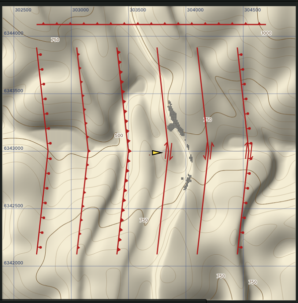
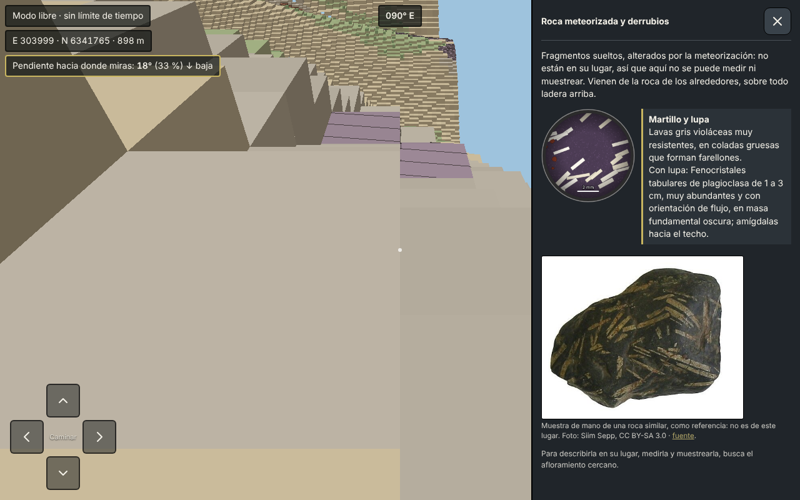

# MineGeology: sound, units at stations, fault symbols, pointing at rock

## What changed

- **The name.** The game is now **MineGeology**. The start screen shows a block-letter title, drawn as SVG from a small pixel font in `game/src/ui/logo.ts`, so it works offline: "Mine" in grey stone, "Geology" in beds of rock colours. The page and PDF titles changed too.
- **Sound** (`game/src/audio/sound.ts`), all synthesised with Web Audio, with nothing downloaded:
  - calm music: slow notes of a pentatonic scale on soft pads, with reverb, over a quiet wind;
  - three blows of steel on stone each time the hammer swings, in time with the gesture;
  - every 20 to 50 s a bird: a few quick whistles, or the harsh, falling cry of a tiuque.
  It starts with the first tap or click, as browsers require. A speaker button turns it off and on, and the choice is kept in the browser.
- **A map unit at each station.** The field panel has "Unidad del mapa": choose one of the map units or create a new one (by default it takes the name the student gave the rock). The station then takes the unit's colour:
  - as a dot on the map board and in the PDF;
  - as a flag on a post in the 3D world;
  - in the GeoJSON (`unit`).
- **Fault symbols:**
  - reverse faults: teeth on the hanging wall;
  - thrusts: larger, closer teeth;
  - normal faults: a bar and ball on the downthrown block;
  - strike-slip faults: a pair of half arrows showing the slip;
  - oblique faults: both.
  The marks stand on the right of the drawing direction. A new tool, "Cambiar una falla", gives a fault the chosen movement, and tapping it again moves the marks to the other side. The PDF draws the same symbols and lists each kind of fault in the legend.
- **Finishing lines on a phone.** A finger moves a little during a tap, and the board took that as dragging the map, so taps added no point. A touch now has 16 px of slack, not 6. A double tap finishes the line, because not every phone sends a double click. The floating ✓ still finishes it.
- **Pointing at rock.** A ray from the crosshair finds the ground cell in sight, up to 14 m away:
  - pointing at an outcrop from close by makes the geologist hammer at it by themself (the gesture, the chips and the sound; it costs no time), and the button offers to work there;
  - pointing at **loose weathered rock** (scree), out of reach of any outcrop, turns the button into a lens: "Mirar" opens a card with the hand-lens view, the description and the photo of the nearest outcrop's rock. It warns that loose pieces are not in place and cannot be measured or sampled.
- **The compass for planes:**
  - the dial shows the strike-and-dip symbol of a geological map: a long strike line and a short tick toward the dip;
  - opening the compass no longer puts the cursor in the fields, so a phone does not pop up its keyboard;
  - the fields used to show examples such as "355/34", which were the attitude of scenario 1, so they gave the answer away; they now show only the form ("000 a 359", "0 a 90", "N__E/__SE").

## Checks

- Unit tests (`tests/faultmarks.test.ts`): the teeth are on the right of the drawing direction or flipped; the ball is on the downthrown side; the half arrows of dextral and sinistral faults are opposite and do not change with the side; a fault without a movement gets no marks. The PDF test finds "Falla inversa" in the legend. 97 tests pass.
- `e2e/aim.mjs` checks that pointing at an outcrop swings the hammer by itself and offers work, and that pointing at scree out of reach opens the card with the lens. 6 checks pass.
- `e2e/touch.mjs` now also checks that the HUD fits when the hammer button shows: ten tool buttons on a phone held upright. 47 checks pass.
- `walk.mjs` (61 checks) and `kinematics.mjs` (8 checks) pass, and the build is clean.

## Left open

- **The sound has not been heard by a person**: the tests cannot listen. Volume, the music, and how often the birds call need trying on a real device.
- On a real phone, the finishing of lines needs trying again; the emulated phone finishes them with taps, a double tap and the ✓.
- The loose-rock card describes the rock of the nearest outcrop, whether or not the student has found it.
