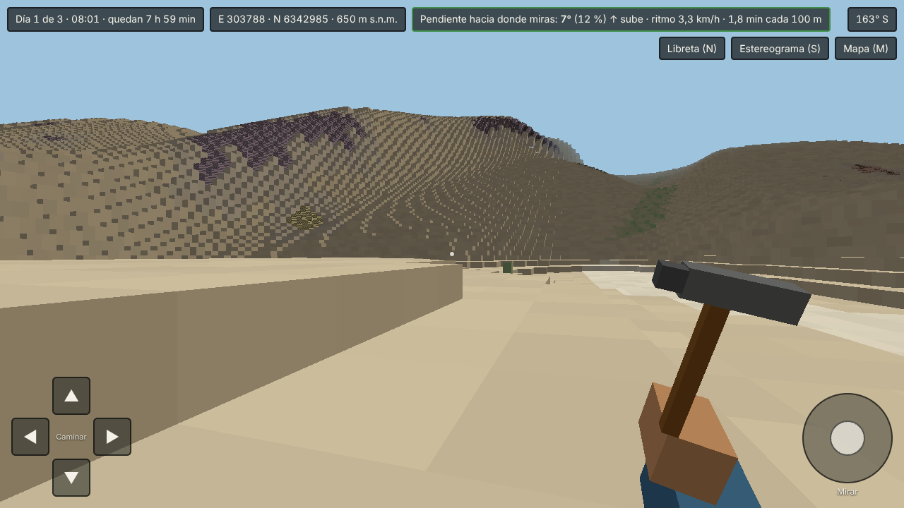
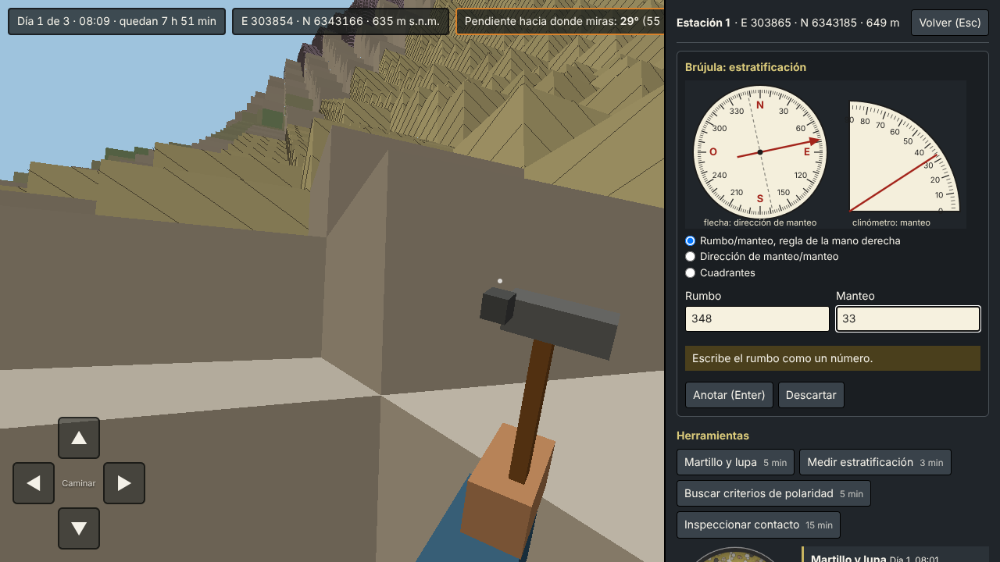
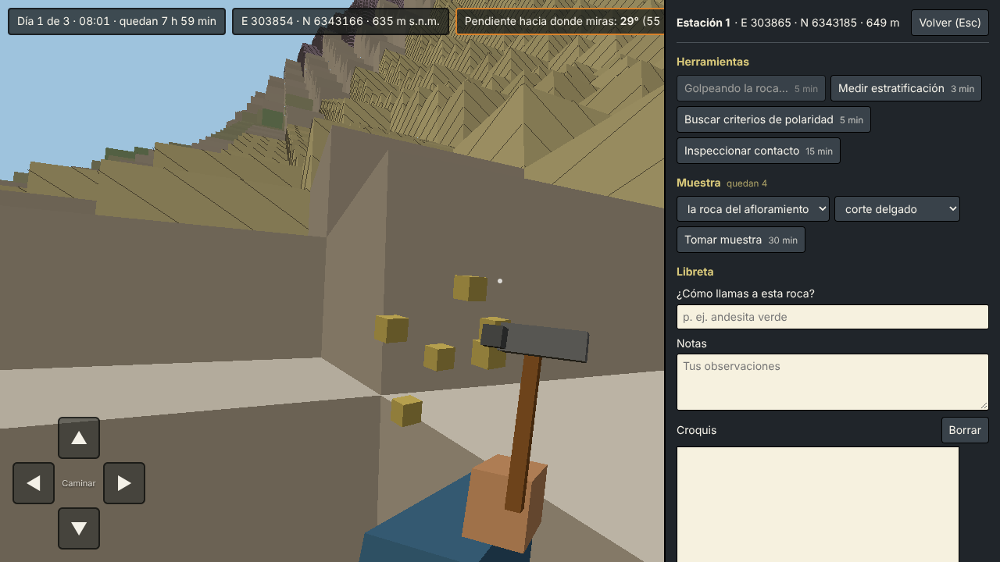
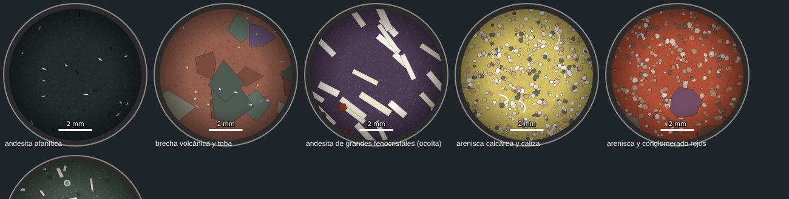

# Field feel: modes, on-screen controls, slope, reading the compass, hammer and lens

Changes asked for by Mauricio after trying work packages 4 to 6. They sit between work packages 6 and 7 and do not change the scenario format.

## What changed

- **Two modes**, chosen when an attempt starts and kept in the save:
  - *Campaign*: the field-day clock; walking costs time, more on slopes and in vegetation, and tools cost time; samples are limited and lab results arrive the next field day.
  - *Free*: no clock and no effort. Slopes and vegetation do not slow the walk, nothing costs time, samples are unlimited and lab results arrive at once.
- **On-screen controls**, always visible: a cross at the bottom left to walk (forward, back, sideways) and a stick at the bottom right to look. They light up whatever drives them (keys, mouse, finger), so it is always clear whether the student is walking or turning the head.
- **Slope**: the HUD shows the slope of the ground in the direction the student faces, in degrees and per cent, whether it rises or falls, and a colour from easy to very steep. In a campaign it also shows the walking pace (Tobler's hiking function) and the minutes per 100 m, which is exactly what the clock charges. Slopes are now taken from the true ground surface, not from the steps of the blocks.
- **Reading the compass**: measuring now shows a compass and a clinometer, with no numbers. The arrow points to the dip direction (as on a Clar-type compass) with a faint strike line across it; the clinometer shows the dip. The student writes the measurement down in the notation they choose:
  - strike and dip by the right-hand rule (355/34),
  - dip direction and dip (085/34),
  - quadrants (N5W/34NE; W or O both accepted).
  Lines (striae) are written as trend and plunge. What the student writes is what goes to the notebook, the map, the stereonet and the exports; what the compass showed is kept next to it. A wrong entry (a dip direction typed as a strike, say) therefore ends up wrong on the map, as it would in a real notebook.
- **Hammer and lens**: the student holds a hammer in a blocky arm, as in a block game. "Martillo y lupa" plays three blows with rock chips in the colour of the rock, and then shows the view through a hand lens: a picture of a few millimetres of the rock, drawn from its texture (phenocrysts, clasts, grains, shells), next to the description.

## Choices made here, open to change

- **Feedback on misreadings in free mode only.** In free mode, if what the student writes is more than 6 degrees away from what the compass shows, the notebook entry is still made and a note asks whether the notation was right. A campaign gives no such hint.
- **Free mode has unlimited samples and immediate lab results**, taking "totally free" literally. Easy to change.
- **The compass shows the dip direction.** A student who writes the right-hand rule has to turn it into the strike; that is part of the exercise. The faint strike line helps without giving the number.
- **The time of a reading is charged when the compass is read**, even if the student discards it.
- **Slope in the direction faced**, not the steepest slope at that point.

## Tests

- Unit tests (`game/tests/fieldfeel.test.ts`): every notation read and written back for strikes every 7 degrees, quadrant cases that must be refused, the axial angle between planes, slope in any direction, campaign against free walking, unlimited samples and immediate results in free mode, the mode and notation through a save (older saves load as campaigns), reading the compass and writing it down.
- End-to-end walk: the two modes are offered; the W key lights the cross; holding the cross's forward button walks; dragging the stick turns the view; the slope and pace are shown; the hammer plays before the lens appears; a bad entry is refused with a reason; eight readings written in three notations read back to what the compass showed; free mode walks without spending time and shows no clock.

## Left open

- **Real tablets and phones.** The cross and the stick work with a mouse and with touch events in the test browser; not tried on a real device.
- **Chips fly from in front of the student**, not from the exact spot of the outcrop that was struck.
- **Steep ground is never impassable**; it only gets slow (below 1 km/h above about 25 degrees).
- **Lens pictures exist for the textures the scenarios use** (lavas, dyke, breccia, sandstone, red beds, conglomerate, ignimbrite, shale); any other texture name gets a generic grain picture.
