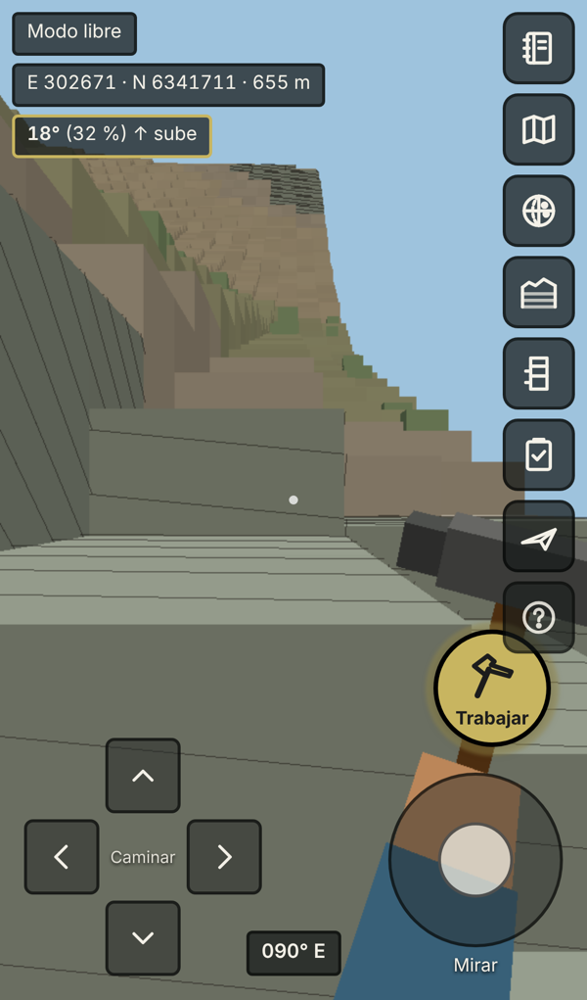
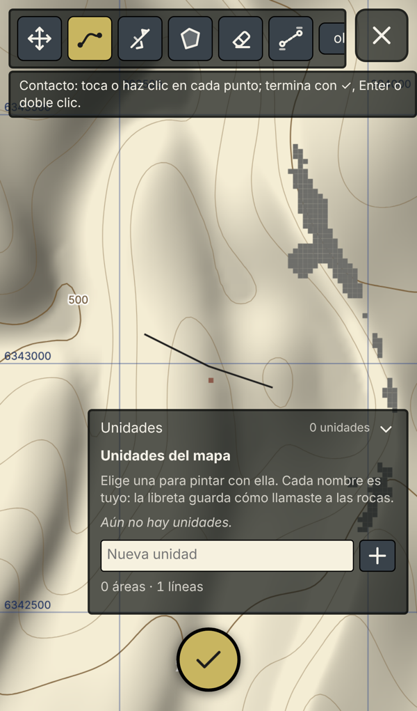
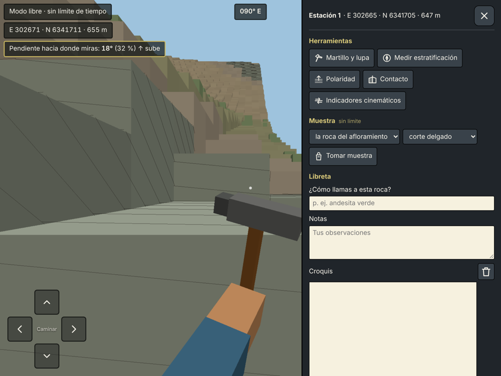

# Tablets and phones: touch interface with icons

## What changed

- **Icons instead of text on buttons.** The tool buttons of the 3D view, the map and the profile are line icons (`game/src/ui/icons.ts`). Each has an accessible name and a tooltip with its key, for example "Mapa (M)". In the panels, an action keeps a short word beside its icon ("Polaridad", "Contacto", "Tomar muestra"), because the icon alone would not say which measurement or test it is. Every panel closes with an ✕ icon.
- **HUD for a finger:**
  - status at the top left (mode or clock, coordinates, slope);
  - the tools in a column down the right, in a row on a phone held sideways;
  - the compass at the top, or at the bottom on phones;
  - the walking cross at the bottom left and the look stick at the bottom right;
  - next to an outcrop, a large round hammer button above the look stick, instead of a text button in the middle;
  - the flight controls are icons above the cross;
  - a help and pause button.
  On narrow screens the long parts of the status lines are hidden ("18° (32 %) ↑ sube · 3,8 km/h"). The layout respects the notch and rounded corners (`safe-area-inset`).
- **Map board:**
  - the tools are one row of icons that scrolls sideways on phones, with a fixed close button;
  - the units panel folds into one line (the selected unit and its colour) until it is opened;
  - the ✓ that finishes a line or area floats at the bottom centre, always in reach;
  - **two fingers zoom** (pinch) and move the map, and a pinch never draws.
  The profile screen works the same way.
- **Panels** on phones: larger text, fields at 16 px so iOS does not zoom when typing, tool buttons in two columns, a header that stays visible while scrolling.
- **Start screen and pause:** on a touch screen the help explains the touch controls instead of the keys.
- **Fix:** a touch could make `setPointerCapture` throw, which stopped the walking cross and some taps on the map. The call is now guarded.

## Checks

- `e2e/touch.mjs` uses real touch events (Chrome DevTools Protocol) on an emulated iPhone 13 held upright and sideways, and on an iPad held sideways. On each device it checks:
  - the touch help is shown;
  - no HUD control leaves the screen or covers another;
  - the tool buttons are at least 40 px;
  - every icon button has an accessible name;
  - the cross walks;
  - the hammer opens the field panel and its ✕ closes it;
  - a pinch zooms the map 3× without drawing;
  - three taps and the ✓ draw a contact;
  - the folded units panel opens;
  - there are no page errors.
  It passes all 35 checks.
- The desktop walk (`e2e/walk.mjs`, 61 checks), the kinematics walk (8) and the unit tests (90) still pass.

## Left open

- These are **emulated** devices in Chromium. No real iPhone, Android phone or iPad has been tried, nor Safari.
- The start screen buttons ("Modo campaña", "Modo libre") stay as text: they are choices that need the words.
- The stereonet, the notebook and the evaluation are readable on a phone but were designed for a wider screen. The stereonet is not zoomable.
- Frame rate on a phone has not been measured.
