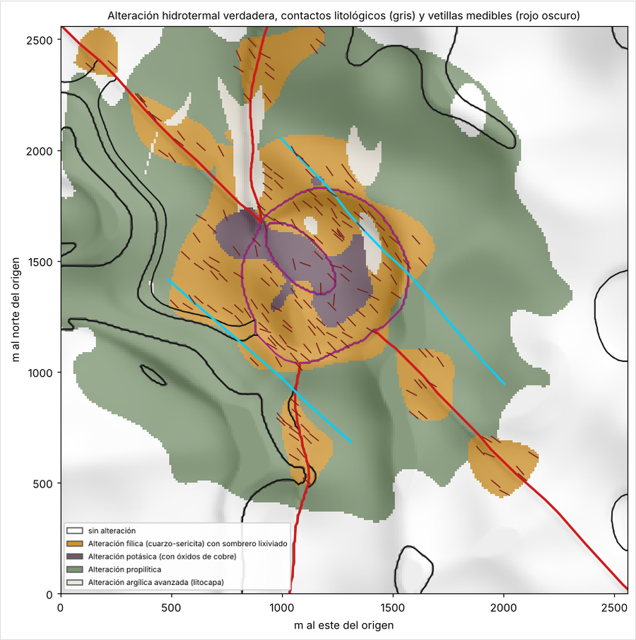
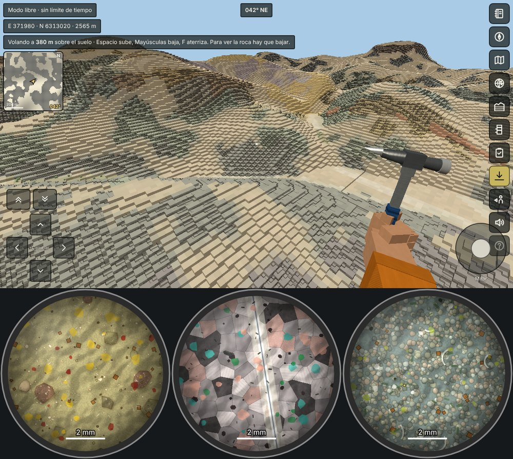
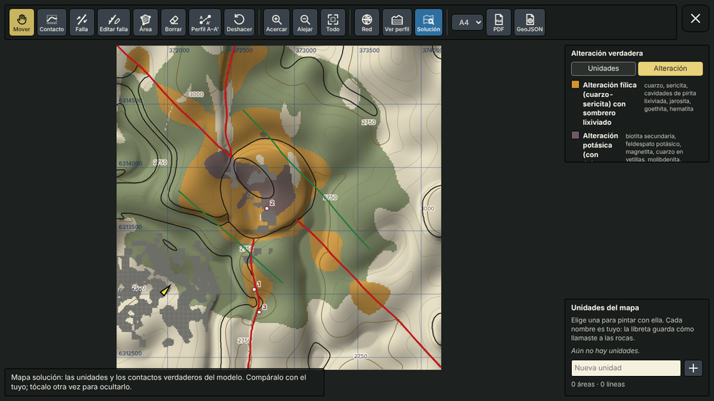

# Ore-deposit models in the scenarios, and a porphyry pilot

## The question

Can the scenarios carry ore-deposit models: a strata-bound body in a suitable bedded succession, or a porphyry system, with alteration zones laid over the lithology, alteration mineralogy, and a position that follows coherent structures?

## Short answer

Yes, with one change to the format. Until now each cell held one unit. Alteration does not fit that: an altered tuff is still a tuff. Writing alteration zones as units, the way contact aureoles are written, would turn every altered rock into a separate map unit. The geological map, the column and the grade would then all be wrong. So format 1.6.0 adds alteration as a **layer of its own over the rock**: the outcrop keeps its unit and also shows a zone, an intensity, its minerals and, often, a vein to measure. Any scenario model can now carry a deposit without touching its geology.

The pilot is a porphyry copper system, **Cerro Amarillo** (`scenarios/cerro-amarillo`), baked and published in two variants. The strata-bound model is designed below and the bake already supports it, but it is not yet authored as a scenario.

## Which scenario suits which deposit

| Scenario | Geology | Deposit that fits | Fit |
| --- | --- | --- | --- |
| Quebrada Los Litres | Jurassic to Lower Cretaceous lavas, breccias, marine beds and red beds of the Coastal Cordillera, cut by dykes | **Strata-bound ("manto-type") copper**, as in the Lower Cretaceous belt of the Coastal Cordillera of central Chile: chalcocite, bornite and chalcopyrite in vesicular lava tops and permeable breccias, near feeder faults and dykes, with albite, chlorite, hematite and calcite; copper oxides at the surface | Very good. The host succession is already there. A steep NNE feeder fault would have to be added. |
| Estero Las Tobas | Cenozoic intra-arc basin fill, an inverted border fault and a Miocene stock | **Porphyry Cu–Mo**, as in the Miocene belt of the Main Cordillera of central Chile | Very good. Used as the base of the pilot, in a new scenario, so that level 2 stays as it is. |
| Valle del Yeso Blanco | Jurassic back-arc limestones, gypsum and red beds in a fold-and-thrust belt | Red-bed copper or a skarn, if a pluton were added | Possible; lower priority. |
| Cerro Pizarras | Paleozoic schists, a Carboniferous granitoid with an aureole, Triassic cover | Gold-bearing quartz veins with sericite halos | Possible, but the forest hides most of it; lower priority. |
| Falla El Tigre (planned, level 6) | Margin-parallel strike-slip system | **IOCG and magnetite–apatite** along the fault, as on the Atacama Fault System | Strong; for when that scenario is built. |

## Why a porphyry first

- **Its structure is analytic.** Estero Las Tobas already had an analytic model, so a scenario on it bakes in about a minute. A GemPy scenario takes half an hour or more.
- **The desert shows the zoning.** About 42 % of the ground is bare rock, so students can follow alteration from outcrop to outcrop and see the colour anomaly from the air.
- **It uses every part of the new layer:**
  - shells around an intrusion;
  - alteration channelled along faults;
  - a cap controlled by elevation;
  - measurable veins;
  - assays.
- **It is the classic exercise** for alteration mapping in economic geology courses.

## The pilot: Cerro Amarillo

**Setting.** Main Cordillera of central Chile, Miocene. The host is an inverted half-graben, as in Estero Las Tobas:

- Oligocene tuffs, then Oligocene to Lower Miocene volcaniclastic sandstones and lacustrine shales, then Lower Miocene andesitic lavas;
- under them, Upper Cretaceous volcanics;
- an east-dipping border fault, reactivated as a reverse fault, with a harpoon anticline.

**Structural control.** The system sits where structures meet, as porphyries in the Andes commonly do:

- The **arc-parallel border fault** (N–S) crosses a **NW-striking transverse fault** (315/80 NE) with a small normal throw (45 m).
- A pre-mineral **granodiorite stock** (U–Pb 12.4 Ma) sits on the intersection.
- A syn-mineral **dacite porphyry** (U–Pb 10.8 Ma) inside the top of the stock is elongated along the transverse fault.
- Both intrusions seal both faults.
- The veins in the phyllic zone strike NW, parallel to the transverse fault. Phyllic alteration also runs out along both faults, well beyond the porphyry's shell.
- **Post-mineral andesite dykes** (Ar–Ar 8.3 Ma), also NW-striking, cross the altered rock fresh. The three ages bracket the mineralisation.

**Erosion level and supergene profile.** The surface cuts the top of the system:

- The advanced argillic lithocap survives only on high ground (above 2 960 m) within 650 m of the porphyry.
- The potassic core crops out only in the deeper valleys (below 2 890 m).
- The zones are described as they look at the surface of a desert range:
  - the phyllic zone is a leached cap of jarosite and goethite in boxwork after pyrite, so it gives low copper;
  - copper oxides (chrysocolla and malachite) show over the potassic core.

**Zones**, from the core outward (a point takes the first that holds it):

| Key | Zone | Where | What the student sees | Cu in a rock-chip assay |
| --- | --- | --- | --- | --- |
| a06 | Potassic, with copper oxides | within 140 m of the porphyry, below 2 890 m | secondary biotite, K-feldspar halos, magnetite, A and B quartz veinlets with molybdenite, chrysocolla and malachite | 1 500–6 000 ppm |
| a11 | Advanced argillic (lithocap) | within 650 m of the porphyry, above 2 960 m | vuggy silica, alunite, kaolinite, pyrophyllite, hematite | 10–120 ppm (Au up to 400 ppb) |
| a03 | Phyllic (quartz–sericite) with a leached cap | within 380 m of the porphyry; within 45 m of the transverse fault or 35 m of the border fault near the system | bleached rock, quartz, sericite, boxwork of jarosite and goethite, D veins | 80–600 ppm (leached) |
| a09 | Propylitic | within 950 m of the porphyry | chlorite, epidote, calcite, disseminated pyrite | 60–350 ppm |
| — | Unaltered | beyond | the rock as described | 25–90 ppm |

Zone limits wander by about 70 m (smooth noise), so they are not perfect offsets of the intrusion.

**Variant b** puts the system 400 m farther south-east along the transverse fault, under lower ground. Erosion has gone deeper there, so more of the potassic core shows and almost none of the lithocap is left. Students in the same class get two levels of the same kind of system.

### What the student does

- **Maps the rock, as in any scenario.** The geological map, the section, the column and the history are graded as before. Alteration does not change any unit.
- **Reads the alteration from the minerals.** The lens describes the altered rock and lists the recognisable minerals, and the lens picture shows them: limonite spots, cubic cavities, green copper oxides, epidote, sericite, veinlets. The zone is never named.
  - Where the alteration is strong, the original texture is described as largely erased, and only the outline of the rock is left.
  - Poor outcrops and loose debris show only the stains.
- **Measures veins.** "Vetilla" is a new plane for the compass. Plotted on the stereonet, the phyllic veins cluster parallel to the transverse fault.
- **Takes assays.** A new lab analysis, *análisis químico (Cu, Mo, Au, Ag)*, gives a rock-chip assay. It is seeded per student and sample and drawn from the zone's ranges. The leached cap gives a lesson: a strongly altered, limonite-rich zone with little copper at the surface.
- **Sees the colour anomaly.** Altered outcrops are stained with the zone's colour, and the debris around them faintly, so the system shows from the air.
- **Checks against the solution (free mode).** The solution map switches between *Unidades* and *Alteración*.
- **Builds the history.** The ages of the stock, the porphyry and the post-mineral dykes bracket the mineralisation. The faults are older than all three.

## The alteration layer (format 1.6.0)

- `units.json` → `alterations`: key, colour, minerals, field and hand-lens descriptions, features, thin section. **No names.**
- `outcrops.json` → `observation.alteration`: the zone covering most of the outcrop and its intensity. Planes may be of kind `vein`.
- `truth.json` → `alteration`: zone names, types and assay ranges, a background assay, and the true alteration map (RLE, 0 = unaltered).
- In `scenario.yaml`, `alteration.zones` lists the zones by priority. Each is a union of regions, and each region is a set of conditions:
  - distance in 3D to a unit or to a fault surface (`within_m`, `beyond_m`);
  - elevation (`above_m`, `below_m`);
  - host rock (`hosts`).
  This expresses shells, channels and strata-bound bodies alike (see [scenario-authoring.md](scenario-authoring.md)).
- The bake code is `bake/geomapper_bake/alteration.py`. The validation report gets a section 7, the alteration map with veins and a table of zones.

## The strata-bound pilot, designed but not yet authored

The same layer covers it. On a Los Litres-like homocline (best written analytically, so it bakes fast):

- **Feeder.** A steep NNE normal fault, through the lower part of the pile.
- **Mantos.** `hosts: [basement, brechas]`, the vesicular lava tops and permeable breccias, `within_m: {feeder: 300}`, and `below_m` under the marine beds. The mantos are then confined to the beds and to the fault's neighbourhood.
- **Alteration types.** `albitic` and `hematitic` (albite, hematite, chlorite, calcite) close to the feeder, and `chloritic` farther out. Copper oxides (chrysocolla, atacamite, malachite) at the surface. Bitumen in the marine beds is a feature of that unit.
- **Assays.** High copper only inside the mantos, near the fault.

The bake test `test_hosts_and_elevation_limit_a_zone` already checks this kind of zone: limited to one host, below an elevation, near a body.

## Checks

- **Python.** 55 tests pass, the 50 that were there and 5 new ones:
  - `tests/test_alteration.py` (4): priority of zones, hosts and elevation, distance to a fault, intensity;
  - `tests/test_scenarios.py::test_cerro_amarillo_…`: the shells are ordered outward; the cap stands high; phyllic alteration follows the transverse fault beyond the shell; outcrops keep their unit and take the zone of most of their cells; the phyllic veins strike NW; the public files name no zone.
- **Bakes.** Both full bakes are valid scenarios, with about 1 650 outcrops each and 41.8 % of the ground exposed.
- **Game.** 111 tests pass, 6 of them new (`tests/alteration.test.ts`): loading, lens text, strong alteration, veins, assays and the stain. The grader gives the answer key of `cerro-amarillo-a` more than 95 % and random attempts less than 20 %.
- **In the browser.** The pilot was loaded and looked at: the colour anomaly from the air, an altered outcrop's lens, the solution map with its alteration layer.

## Left open

- **Mauricio's approval** of the reports (`build/cerro-amarillo-a/report.html`, `-b`).
- **Alteration is not graded**, and the map board has no alteration layer of its own. A student can define map units for zones or write them in the notebook.
- **Alteration does not shape the land.** A silicified cap would stand as a ridge and a phyllic zone would wear into valleys. The procedural terrain only knows the units' resistance.
- **No alteration in 3D.** Only the surface is classified, so sections and reveal mode show none.
- **The supergene profile** (leached cap, oxide zone, enriched blanket) exists only as surface descriptions. Drill holes would be the way to show it.
- **No photos** for the new rocks and zones.
- **The strata-bound scenario** is designed above but not authored.
