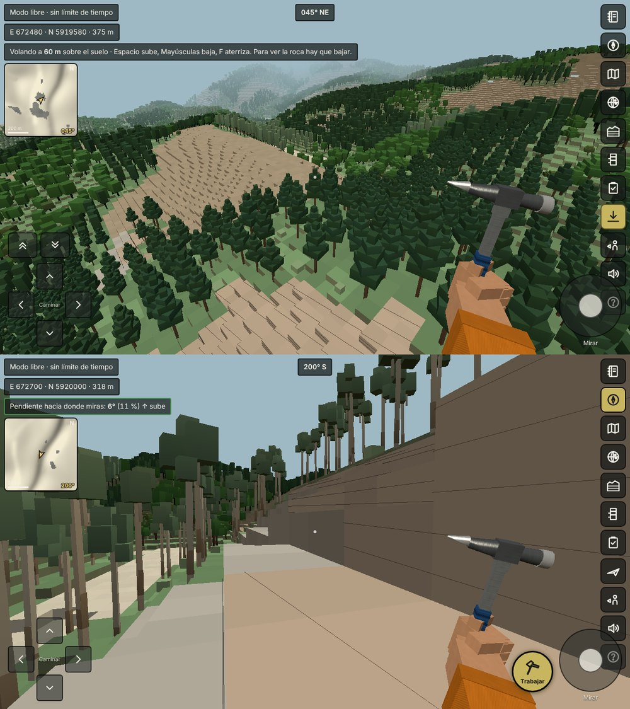
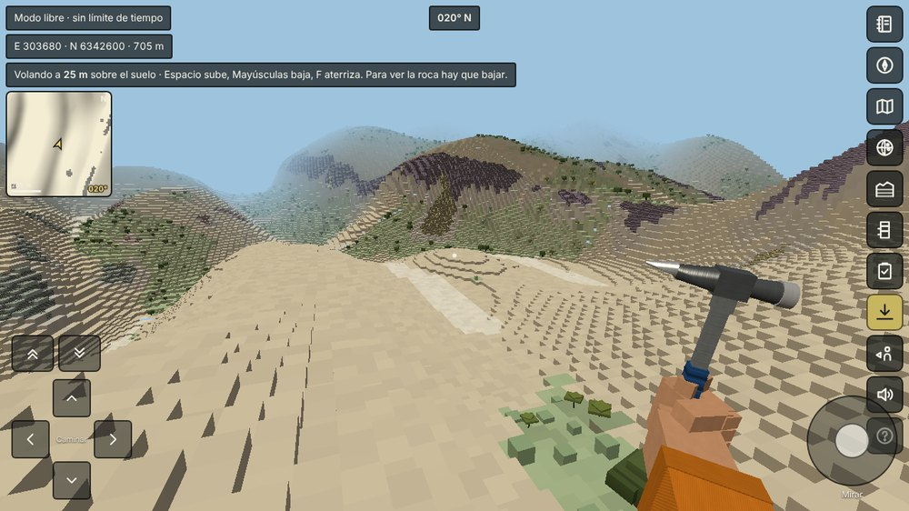

# More realistic trees

## What changed

The trees were a brown box and a green box, all alike, on the vegetated cells of a forest. They are now still blocky, but each environment has its own woods (`game/src/world/trees.ts`, `game/src/world/treeplaces.ts`).

| Environment | Trees | Where |
| --- | --- | --- |
| Forest (Cerro Pizarras, Coastal Cordillera near Concepción) | **Radiata pine** (a straight bare trunk, a narrow crown of tiers); **eucalyptus** (a tall pale trunk, a high, open crown of a few clumps); **native evergreen forest** (a thick trunk forking into a broad, lumpy crown), with some sclerophyllous trees among them | Pine and eucalyptus in **rectangular plantation stands, in rows**; native forest between them, with trees anywhere in the cell. |
| Temperate (Quebrada Los Litres, Valle del Yeso Blanco) | **Sclerophyllous trees** (quillay, peumo, litre: a short trunk that splits, a wide, dense, dark crown) and **espinos** (a crooked trunk, a flat umbrella crown) | About one vegetated cell in eight; until now this land had only shrubs. |
| Desert | None | |

Each tree:

- **Shape.** It is built from four to nine boxes. The vertex colours are darker inside and below the crown and lighter on top, a cheap ambient occlusion.
- **Variety.** Each tree is turned and leaned on its own and tinted a little, and its height falls within the range of its species: pine 17–24 m, eucalyptus 21–29 m, native 11–18 m, sclerophyll 5.5–9.5 m, espino 3–5 m.
- **Wind.** The crowns sway gently. The motion is stronger toward the top and out of step from tree to tree, with slow gusts. It runs in the vertex shader and costs nothing on the CPU.
- **Shade.** The ground under a crown is drawn darker, and no shrub grows there. The mesher reads the same placement rule (`treeAt`), which is kept free of three.js because the mesher runs in a worker.

## Performance

Cerro Pizarras has about 35 000 trees (14 100 pines, 11 900 native, 5 900 eucalyptus, 2 700 sclerophyllous); Quebrada Los Litres about 1 700. Within 240 m of the student they are drawn in full, one instanced mesh per species: about 1 000 trees in the forest. Farther away they are drawn as a trunk and one crown box, shaped and coloured by species, in a single instanced mesh. The near set is refreshed when the student has moved 35 m: the trees that come near are hidden from the far mesh and written into the near ones. In all there are at most six draw calls for the trees.

## Checks

- Typecheck and the 111 unit tests pass.
- Looked at in the browser, from the ground and from the air, in the forest and on temperate land.

## Left open

- The trees still do not stop the student and cast no real shadows (only the darker ground under them).
- The frame rate on a real laptop or tablet with the new trees has not been measured; the checks ran on a software renderer, too slow to judge it.
- Where native forest grows (ravines, south-facing slopes) is not modelled; stands are placed by noise.
