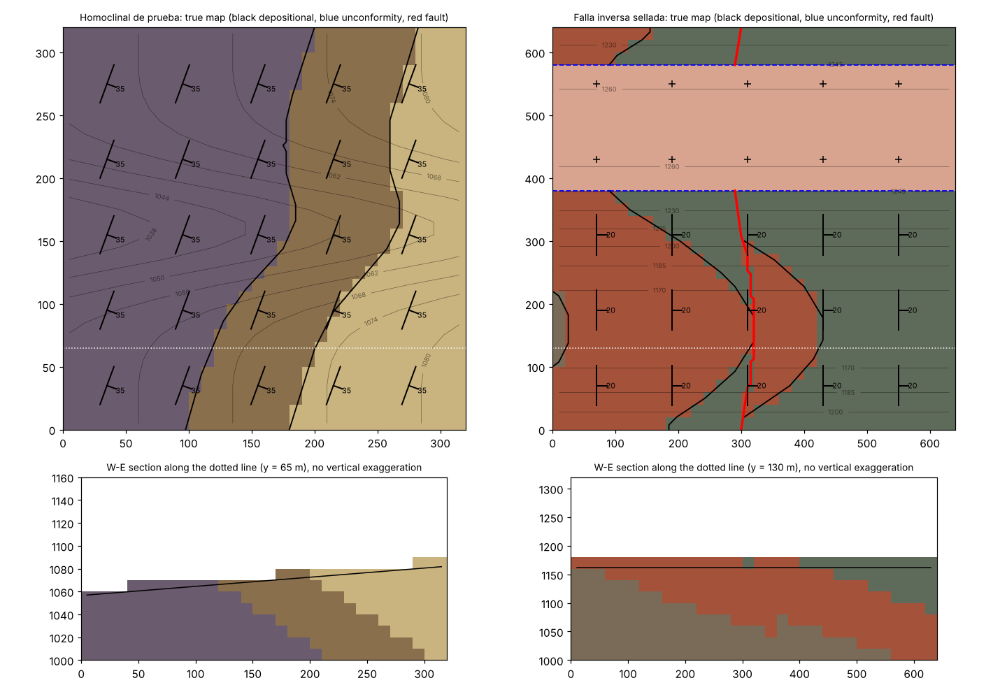

# Work package 2: bake core

## What was built

`geomapper bake <scenario>` runs a GemPy model and writes a valid scenario folder (format 1.0.0):

- `bake/geomapper_bake/runner.py`: evaluates a GemPy model at arbitrary points and returns, for each series and fault, the scalar field and its analytic gradient. It is the only module that imports GemPy.
- `bake/geomapper_bake/bake.py`: terrain, lithology block, bedding field, true map, contact and fault traces, column, and the files.
- `bake/geomapper_bake/traces.py`: vector traces from rasters sampled on the terrain.
- `bake/geomapper_bake/scenario_config.py`: reads and checks `scenario.yaml`. The authoring guide is `docs/scenario-authoring.md`.
- `bake/geomapper_bake/authoring.py`: optional helpers for `model.py`.
- Two test scenarios in `bake/tests/scenarios/`: a homocline, and tilted beds cut by a reverse fault and sealed by a flat cover.

Done-when test: `test_bedding_matches_input_within_one_degree_at_every_cell`. For the homocline (strike 020, dip 35) every one of the 16 384 cells stores a pole within 1 degree of the input; the residual is the 8-bit rounding.

## How it works

1. One GemPy evaluation covers the block's cell centres, the terrain surface at each cell, and the terrain surface at four times the resolution.
2. The lithology block is GemPy's unit at each cell centre.
3. The bedding pole of a series is the normalised gradient of its scalar field, kept only in cells that belong to that series. GemPy computes this gradient analytically, so it is not a finite difference across cells.
4. The true map is the unit at the terrain surface of each cell, evaluated at the exact stored elevation.
5. Traces are the boundaries of the refined surface raster, joined into lines and simplified. The tests hold every trace within half a cell of the analytic contact or fault.

## Findings

- **Bedding next to faults is clean.** The architecture lists noisy bedding near faults and unconformities as a risk. With the analytic gradient it did not appear: in the faulted test model the largest deviation from the input dip is below 0.001 degrees before rounding, including the cells that touch the fault. The mask buffer therefore defaults to 0 cells. It stays available as `bake.mask_buffer_cells` for models where the interpolation itself bends beds near a discontinuity (finite faults, few data).
- **Cost.** A prototype run of 786 000 points with three groups took 81 s and 0.7 GB on 4 cores. The default grid of the architecture (256 x 256 x 96, 6.3 million cells) should take around 11 minutes per variant. This was extrapolated, not measured.
- **GemPy version.** Built and tested against GemPy 2026.0.3. The runner reads the per-group fields from `solution.octrees_output[...].outputs[...]`, which is not a documented public interface; a GemPy upgrade can break it, and the tests would show it at once.

## Left open

- **Exposure.** `cover.bin` is all soil and `outcrops.json` is empty until work package 3.
- **Fold axes** are written as an empty list. Deriving them belongs with the first folded scenario (work package 8).
- **Dykes and other thin bodies.** GemPy cannot model a dyke a few metres wide on a 10 m grid. Scenario 1 needs them, so work package 3 has to add them by rule after GemPy.
- **Real DEMs.** Terrain comes from a function in `model.py` or a `.npy` file. Reading a GeoTIFF with rasterio and the procedural terrain driven by rock resistance are not built yet.
- **Trace gaps at junctions.** Traces are cut where three units meet, and lines shorter than one cell are dropped.
- **Public and private output.** The bake writes one folder with everything. Splitting the public part into `baked/` comes with graded mode.
