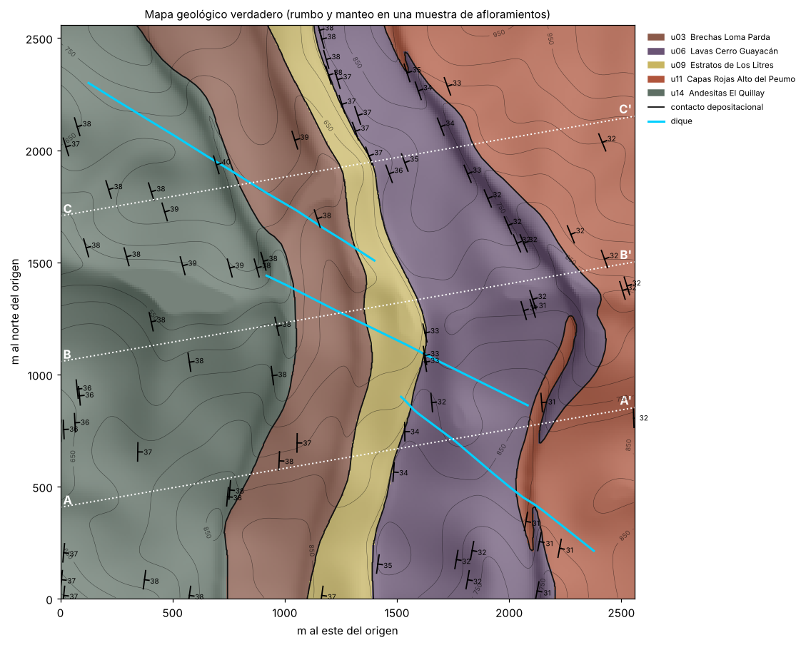
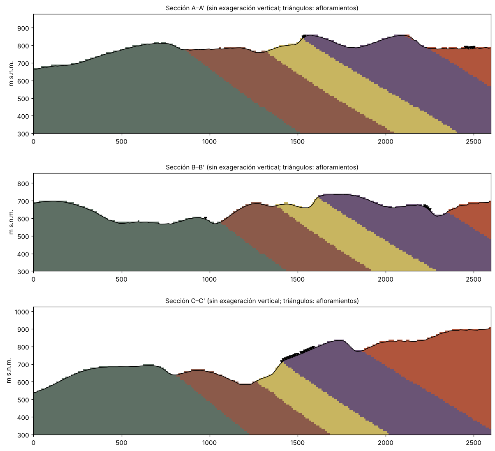

# Work package 3: exposure, outcrops, validation report and scenario 1

## What was built

- `bake/geomapper_bake/terrain.py`: procedural terrain. Regional slope plus smooth random relief, raised where the rock at the surface is resistant, then cut by valleys along the computed drainage.
- `bake/geomapper_bake/exposure.py`: the exposure model. Each surface cell gets a score from slope, ridge position, stream incision, rock resistance and a patchy random field; the top-scoring cells, up to the target fraction, become bare rock. The rest is soil, alluvium on valley floors, scree below steep rock, and vegetation on south-facing slopes and along streams. Rock cells are grouped into outcrops of at most 6 cells a side.
- `bake/geomapper_bake/outcrops.py`: the outcrop catalogue and the rule-based structures. Dykes are planes intersected with the terrain; fault striae follow the stated kinematics.
- `bake/geomapper_bake/report.py`: the validation report, written by `geomapper bake --report`.
- `scenarios/quebrada-los-litres/`: scenario 1, with three variants.
- Format 1.1.0: `truth.json` gains an optional `dykes` list.

## Scenario 1 as proposed

Quebrada Los Litres is modelled on the Jurassic to Lower Cretaceous pile of the Coastal Cordillera of central Chile. All names are invented.

| Unit (oldest first) | Rock | Age | Thickness |
| --- | --- | --- | --- |
| Andesitas El Quillay | porphyritic andesite lavas | Upper Jurassic | base not exposed |
| Brechas Loma Parda | volcanic breccia and tuff | Upper Jurassic to Lower Cretaceous | 270 m |
| Estratos de Los Litres | fossiliferous calcareous sandstone and limestone | Valanginian to Hauterivian | 180 m |
| Lavas Cerro Guayacán | andesite with large plagioclase phenocrysts (ocoíta) | Barremian to Aptian, Ar-Ar 121.4 ± 1.6 Ma | 310 m |
| Capas Rojas Alto del Peumo | red sandstone and conglomerate | Albian | top eroded |
| Diques El Maitén | three subvertical andesite dykes striking north-west | Ar-Ar 93.1 ± 0.9 Ma | 4 to 8 m |

Beds strike 349 to 008 and dip 31 to 40 degrees east, with a gentle warp so that the readings are not all identical. The ocoítas are the most resistant unit and form a cuesta with its scarp facing west over the recessive marine beds. The dykes are near vertical and cut tilted beds, so the two lab ages bracket the tilting between about 105 and 93 Ma. The two lower volcanic units are marked as lumpable.

Full-resolution bake of variant a: 256 x 256 x 96 cells of 10 m, relief from 451 to 1045 m, 5.0 % of the area exposed in 383 outcrops, 48 of them showing a contact or a dyke.

## Done when

"The report shows 3 to 8 % exposure and Mauricio approves the true map and sections." The first half holds (5.0 %). **The approval is pending.**

## Choices made here

- **Exposure is a quantile, not a probability draw.** The architecture describes sampling an outcrop probability. Thresholding a score that includes a seeded random field gives the same patchy result and hits the target fraction exactly, which makes the 3 to 8 % requirement easy to hold.
- **Dykes are lines.** A dyke 4 to 8 m wide cannot be a map unit on a 10 m grid. Its rock is a unit that students can describe, but it lives in `truth.dykes` and in the outcrops it crosses, not in the block or the map raster.
- **One unit per outcrop.** An outcrop that spans a contact reports its main unit and names the other in `contact`.
- **Observation texts are Spanish only** (`outcrops.py`), following the default interface language.

## Left open

- **The scenario sources are the answer key.** `model.py` and `scenario.yaml` hold names, ages and geometry. If this repository is public, students can read them. Graded use needs the scenarios in a private repository, or the repository itself private.
- **Marine beds are scarce.** Estratos de Los Litres has 15 outcrops (2.7 % of its area exposed) against 163 for the ocoítas. This is realistic for a recessive unit and makes it the hard one to map; raise its `resistance` to change it.
- **Straight channel segments.** The drainage is routed to eight neighbours, so some streams run in long straight lines.
- **Sampling a dyke.** An outcrop reports one unit, so the lab returns the host rock; the dyke's age reaches the student only when the game handles it (work package 5).
- **Variants b and c** are defined but were not baked at full resolution or reviewed.
- **Real DEMs** (GeoTIFF through rasterio) are still not supported.
- **Bake time** at full resolution was about half an hour on 4 cores for this scenario, not the 11 minutes extrapolated in the work package 2 note: more control points make each GemPy evaluation slower.
