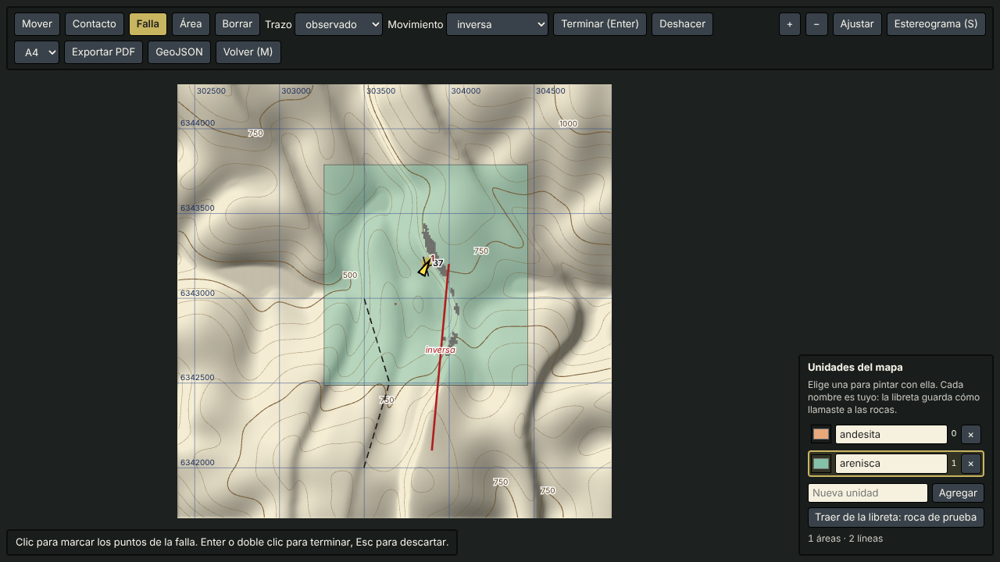
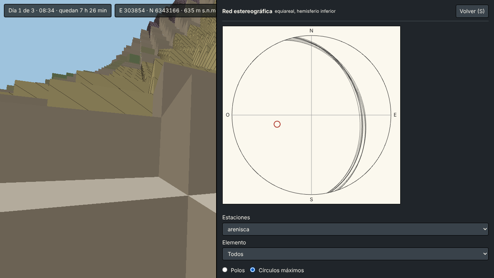
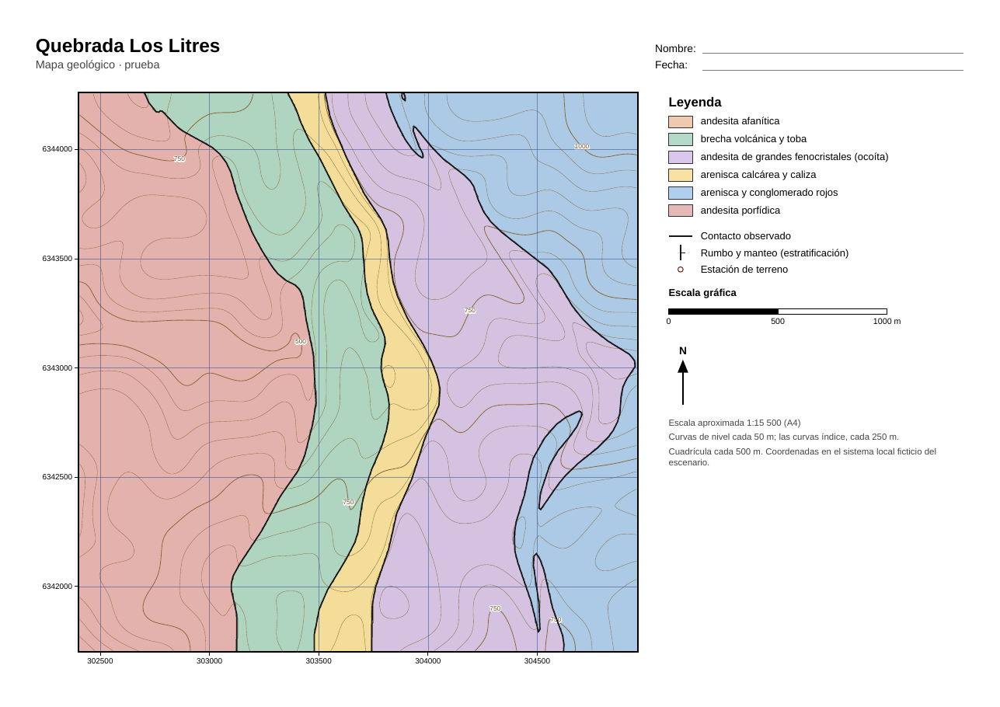

# Work package 6: map board, stereonet and export

## What was built

- **Map board** (key M): the topographic base and the fog of war, with the tools to draw the geological map on it.
  - Tools: contact, fault, area (polygon), erase, and move. Lines are drawn as observed (solid), approximate (dashed) or inferred (dotted); a fault also takes a kinematics (normal, reverse, thrust, dextral, sinistral, oblique) or none.
  - Units are the student's own: add, rename, recolour, remove, or bring in the rock names from the notebook. An area is painted with the selected unit; where areas overlap, the last one drawn wins, as ink does on paper.
  - Zoom with the wheel or the buttons, move by dragging with any tool, undo with Ctrl+Z (60 steps), Esc drops the line in progress, Enter or a double click finishes it.
  - Stations appear with the mean strike and dip of each kind of plane measured there, and their number.
  - Contours are vector lines (marching squares every 50 m, index lines every 250 m) over a shaded relief of the true terrain.
- **Stereonet** (key S): equal-area, lower hemisphere. Poles or great circles of the student's planes, points for lines (striae, hinges). Filter by the name given to the rock, by map unit (a station belongs to the unit whose area it lies in) and by kind of plane. It reports the mean plane of a cluster, or the axis and plane of a girdle (the fold axis when the poles are the two limbs of a fold), with the eigenvalues. PNG download.
- **Export**: GeoJSON (units as polygons, contacts and faults as lines, stations and strike-and-dip symbols as points, in the scenario's easting and northing) and a print-ready PDF (A4 or A3: coordinate grid, contours with labels, shaded relief, the drawing, legend, graphical scale, north arrow, approximate scale and a line for name and date). The PDF writer is 200 lines and has no dependencies.
- **Saved with the attempt.** The map is part of the saved state; saves from before this package load with an empty map.
- `rasterize(map, nx, ny, cell)` turns the drawn areas into a raster of unit ids in the same layout as the baked true map. Work package 7 compares the two.

## Done when

"A complete map of scenario 1 can be drawn and exported."

- **Complete map, from the answer key.** A test builds a careful student map of Quebrada Los Litres from the true units and contacts (`tests/helpers/studentMap.ts`: six unit areas and the contact lines) and checks it: the painted areas agree with the true map in 100 % of the cells, and a shaky version (vertices shifted by 12 m and simplified to 165 points) in 97.4 %. The first figure checks the round trip from contour to polygon to raster, since the map is outlined from the true raster itself; it says nothing about how well a person draws. The GeoJSON stays inside the area and the PDF is valid. The PDF below is that map. **It was generated by code from the answer key, not drawn by a person.**
- **Drawing with the interface.** The end-to-end walk in a real browser works an outcrop, then draws units, an area, two contacts and a fault with real clicks, uses undo and erase, exports both files, reads them back, opens the stereonet and reloads the page to check that the map is still there. The map it draws is small (one area, a few lines), not a complete geological map.
- The exported PDFs were also read with two other programs (`pdfinfo`, `pypdf`) and drawn with `pdftoppm`.

## Choices made here

- **Areas are drawn by hand.** There is no flood fill between lines. A student closes each area by clicking its outline, which is what the architecture's "fills polygons" needs and what the grader will rasterize.
- **Unit by position.** The stereonet's "map unit" filter uses the station's coordinates and the areas, so it works only once areas are drawn. The rock name written in the notebook is the other filter.
- **Contours in vector.** The first version drew them pixel by pixel, which looked broken when zoomed; vector lines are also what the PDF needs.
- **Gender in the legend.** "Contacto observado", "Falla inferida".
- **A scale printed on the PDF** is approximate (rounded to 500) and depends on the paper size.
- **GeoJSON is in the local grid, not longitude and latitude**, and says so in its header. A GIS program needs to be told that it has no coordinate system.

## Left open

- **Fault symbols.** The kinematics is stored and printed as a word at the middle of the line; there are no ticks, teeth or arrows, and the dip direction of a fault is not recorded.
- **No fold axes or axial traces** can be drawn yet, and no dip symbols for cleavage or foliation other than the strike-and-dip of measured planes.
- **Cross-section, column and history** are work package 7.
- **Tablets and phones.** The board works with touch for drawing and moving, but there is no pinch zoom, and the toolbar covers part of the map on a narrow screen. Not tried on a tablet.
- **The PDF repeats numbers in its text layer** (the white outline behind each label is the same text drawn twice), so copying the elevations gives them doubled. The page looks right.
- **The stereonet shows no density contours or confidence cones.** A fold axis is meaningful only when the folds are cylindrical and the poles really form a girdle; the fit says "dispersos" when they do not.
- **The shaded relief in the PDF** is a 3 pixel per cell JPEG, so it is soft when printed on A3.
