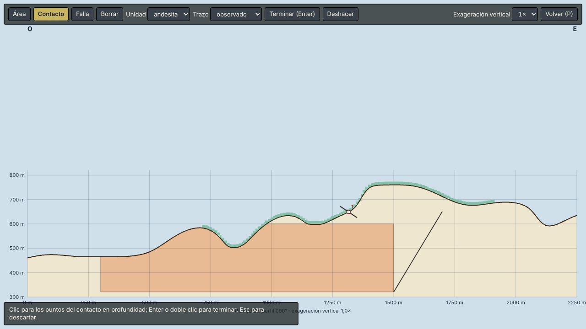
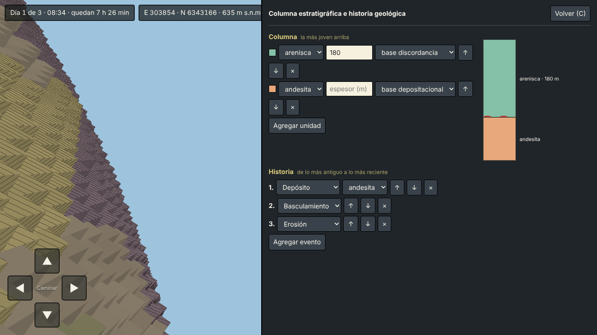
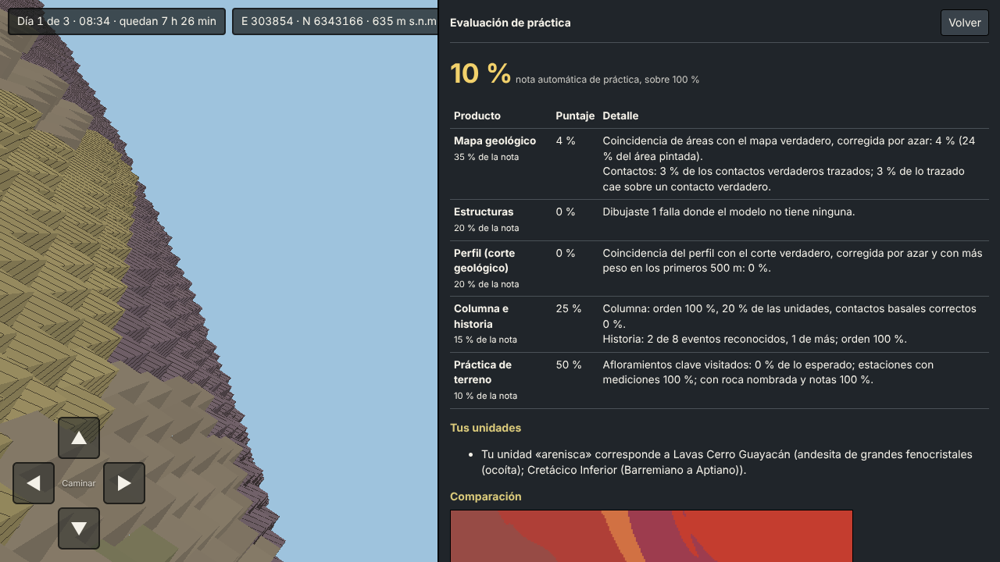

# Work package 7: cross-section, column, history and the grader

## What was built

- **Cross-section** (tool "Perfil" on the map board, then key P): two clicks on the board set the line A–A'. The profile screen shows the true topography along it (10 m steps), the stations within 150 m projected onto it, and the bedding measured there drawn at its **apparent dip** on the section's azimuth. The student draws:
  - areas (polygons painted with one of their map units),
  - contacts and faults at depth, as observed, approximate or inferred,
  - and can erase, undo (Ctrl+Z) and choose a vertical exaggeration (1×, 2× or 3×).
  Only one section per attempt; drawing a new line asks before it clears the old drawing.
- **Stratigraphic column and history** (key C). The column is a list of the student's units, youngest at the top, each with an optional thickness and the nature of its base (depositional, unconformity, intrusive, faulted, not exposed). It is drawn as a column beside the list. The geological history is an ordered list of events (deposition, tilting, folding, faulting, intrusion, erosion, metamorphism, uplift); deposition and intrusion take a unit.
- **Evaluation** (button "Evaluar", only when the bake ships its practice answer). After a confirmation it grades the attempt and shows:
  - the total and the five parts with their weights and a sentence each on what counted,
  - which of the student's units was matched to which true unit, now with the true name and age,
  - the student map over the true map, with the cells that disagree in red,
  - the true section beside the student's.
- **Practice answer for the section.** `publish --practice` now also writes `practice-litho.bin`, the lithology block hidden the same way as `practice.bin` (gzip, then XOR with its own hash). It is a practice aid: anyone can read it with the browser's tools, as the format notes say.
- **Reference photos** (also in this branch): units may list photos of a similar rock (hand sample, thin section in plane and crossed polars, outcrop). The bake copies them, lists them with their hashes in the manifest (`assets`, format 1.2.0), and the game shows them under the hand lens and with the lab results, with the credit and the licence and the warning that they are not from this place. Scenario 1 has ten provisional open-licence photos from Wikimedia Commons ([credits](photo-credits.md)); `geomapper photos` replaces them in a bake.

## How the grade works

The student names their own units, so the first step is to decide which of them is which true unit.

1. **Matching.** For every pair (student unit, true unit) the grader counts the map cells where both are present. The Hungarian algorithm picks the one-to-one assignment with the largest total overlap. Then each unpaired student unit joins the true unit it overlaps most, and the true units that the scenario declares `lumpable` (for example two lava members) may be taken together when the student drew them as one. A pair with no overlap is not a pair.
2. **Map, 35 %.** Cohen's kappa between the painted map and the true map on the cells the student painted, times the fraction painted, is 70 % of this part: kappa removes the agreement a map gets by chance. The other 30 % is the contacts: how many of the true contacts have a student line near them (recall), and how much of what the student drew lies near a true contact (precision). "Near" depends on how the line was drawn: 30 m for observed, 45 m for approximate, 60 m for inferred. So an inferred line in the wrong place costs less than a confident one. Outlines of areas count as contacts, except along the edge of the map.
3. **Structures, 20 %.** For faults: was each true fault found, how much of its trace was followed, and was the kinematics right. For folds: the fold axis from the girdle of the bedding poles against the true axis. Faults drawn where the model has none give zero. When the scenario has neither faults nor folds and the student drew none, the part is left out and its weight is shared among the others; this is the case of Quebrada Los Litres.
4. **Section, 20 %.** Kappa between the student's section and the true section cut from the lithology block on the same line, with weight 1 in the upper 500 m and 0.3 below, since the deep part is a guess even for an expert.
5. **Column and history, 15 %.** The column: Kendall's tau between the student's order and the true order of the matched units, times the share of map units in it, and the right nature of the bases. The history: events matched by type and unit (F1), then their order (tau). Events whose unit is not a map unit, such as the intrusion of dykes, are matched by type alone.
6. **Field practice, 10 %.** Share of the key outcrops visited against a target of 40 %, the density of stations, and how complete the notes are (rock named, measurements, observations).

Every number is shown to the student with a sentence, so the grade can be argued.

## Done when

"A perfect student attempt scores above 95 % and random maps score below 20 %."

- **Perfect attempt.** A test builds it from the answer key (`tests/helpers/studentAttempt.ts`): the true map outlined as areas, the contacts as lines, the true section on a line across the map, the column and history in the true order, and stations on the key outcrops. It gets **99.8 %**: map 99.6, section 100, column and history 100, field 100; structures left out (no faults or folds). Like the map in work package 6, it is made by code from the answer, not drawn by a person.
- **Random attempts.** Eight seeds, each with random areas, lines, section, column and history: **3.5 % to 13.5 %** (mean 8.2 %). The column part is the highest (9 to 49 %), because a random order of five units still agrees in part with the true one.
- **Other tests**: the one-to-one assignment, lumped units, the apparent dip, the projection of stations, the true section, an empty attempt (0 %), an attempt without the lithology block (the section is left out), inferred against observed lines, and invented faults.
- **In the browser.** The end-to-end walk now also draws a profile line, an area, a contact and a fault in it, fills the column and the history, and asks for the evaluation; the rough attempt gets 10 %. It checks that the photo loads and that the section and column survive a reload. 60 checks, no page errors.

## Choices made here

- **Kappa, not the plain share of agreeing cells**, because a map painted with the most common unit already agrees in a large share of the cells.
- **Matching by overlap**, so the student never has to use the true names, and a lumped map is not punished when the scenario allows lumping.
- **Tolerances by line style** reward saying how sure you are.
- **A deeper section counts less.** Below 500 m the true section is mostly the model's own interpolation.
- **Parts that do not apply are left out**, and their weight goes to the others, rather than giving free points.
- **The answer stays out of reach of a casual look** (hidden bundles), but it is not secret. The architecture keeps real assessment on a server for later.

## Left open

- **Dykes cannot be drawn on the map** as a unit or as a line; they are in the history only.
- **The fold axis is graded from the bedding poles**, not from axial traces drawn on the map, which cannot be drawn yet.
- **One section per attempt.**
- **No density of stations by area of each unit**, only overall.
- **The weights and thresholds are first guesses** and need trying with real students: which part is too strict, which too generous.
- **Not tried on a tablet**; the profile screen has the same limits as the board (no pinch zoom).
- **Kinematic indicators** (steps, Riedel fractures, drag, tension gashes, S–C, sigma clasts) were asked for and go into work package 8, with the scenarios that have faults.
