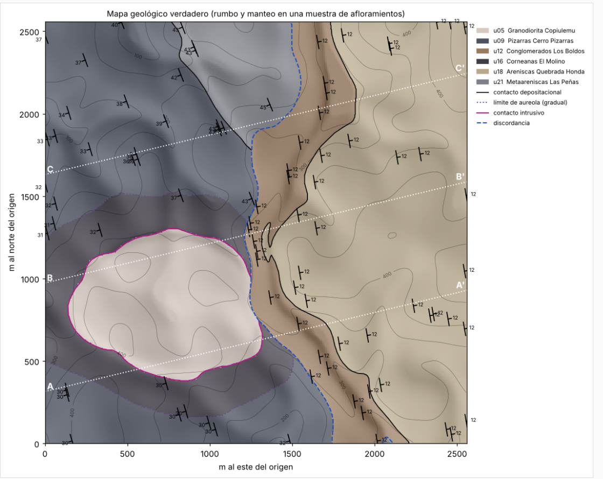
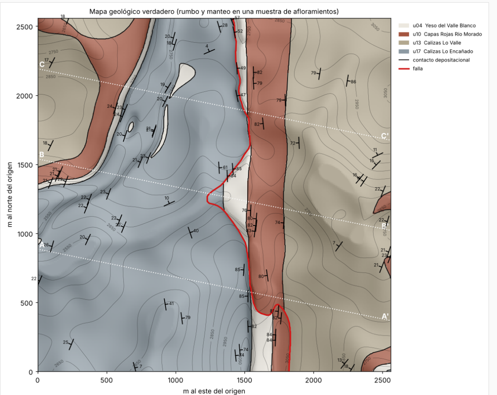
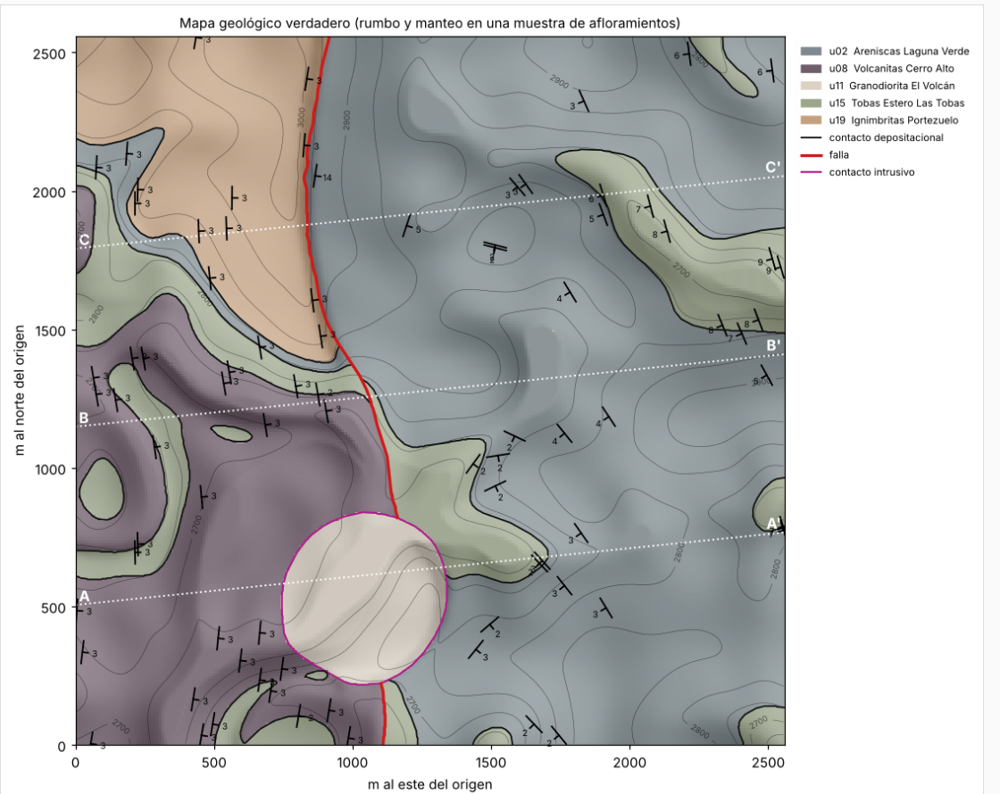
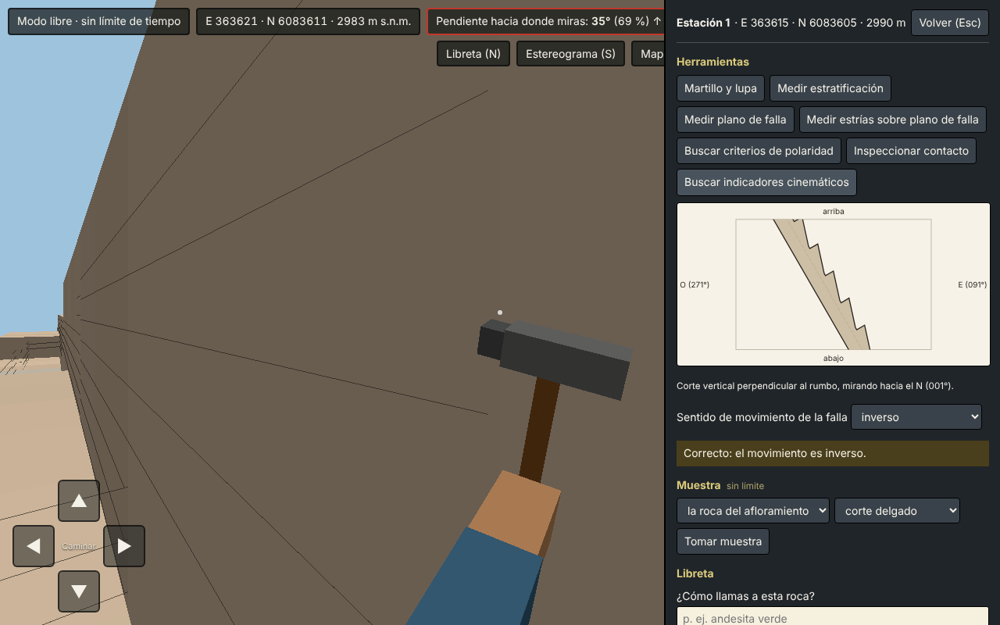

# Work package 8: scenarios 2 to 4, kinematic indicators and the start screen

## What was built

### Three new scenarios, each with two variants

| Level | Scenario | Structure | How it is modelled |
| --- | --- | --- | --- |
| 2 | **Cerro Pizarras** (`scenarios/cerro-pizarras`) | Slates over metasandstones with a regional foliation; a granodiorite stock with a hornfels aureole; an angular unconformity under gently tilted Triassic conglomerates and sandstones | GemPy; the aureole is added by the bake |
| 3 | **Valle del Yeso Blanco** (`scenarios/valle-del-yeso-blanco`) | Jurassic limestones, gypsum, red beds and ammonite limestones folded into an east-vergent anticline–syncline pair with an overturned common limb, cut by a west-dipping thrust that repeats the gypsum | GemPy, from an inclined, sheared sine fold |
| 4 | **Estero Las Tobas** (`scenarios/estero-las-tobas`) | A half-graben fill of tuffs, volcaniclastic sandstones and ignimbrites that thickens toward an east-dipping border fault; the fault was inverted, so the tuffs show a normal separation and the ignimbrites a reverse one; a Miocene stock seals the fault | Analytic (see below) |

Variant b of each changes the geometry (attitudes, fault dip, position of the stock) and the seed, so the outcrops are different too.

### New in the bake (format 1.3.0)

- **Contact aureoles.** `aureoles:` in `scenario.yaml` turns host rock within a true 3D distance of an intrusion into an aureole unit, in the block, the map and the traces. Its outer limit is a new contact type, `gradational`. The hornfels keeps the foliation of its host.
- **Foliation.** A series of kind `metamorphic` gives foliation planes, not bedding.
- **Fold axes in the answer key.** `fold_axes(ctx, ground)` in `model.py` returns the axial traces and the axis of each fold. The grader already compared the student's stereonet axis with them; until now no scenario had any.
- **Analytic models.** `build_analytic(ctx)` replaces GemPy where it cannot express a structure, as section 11 of the architecture foresaw. It answers the bake with the same interface (rock, scalar fields, gradients). Estero Las Tobas uses it: with GemPy, the jump in thickness across the fault was smoothed into a broad warp with false dips of up to 75°.
- **Kinematic indicators.** Outcrops on a fault carry an indicator (`steps`, `riedel`, `drag`, `tension_gashes`, `sc_fabric` or `sigma_clast`) and the sense of slip. Every exposed fault shows one on at least one outcrop. They use a random stream of their own, so the rest of a scenario's outcrops are unchanged.
- **A one-line `summary`** in the manifest, and `geomapper publish` now writes `baked/index.json`, the list of published scenarios.

### New in the game

- **Start screen.** With more than one scenario published, the game opens on a list: title, level, summary and one button per variant, marked "continuar" where there is a saved attempt. Each variant keeps its own save. The overlay offers "Cambiar de escenario" afterwards. `?s=<folder>` still opens a scenario directly.
- **"Buscar indicadores cinemáticos"** (10 min) in the field panel. On a fault outcrop with an indicator it draws a field sketch:
  - dip-slip faults in a vertical section across strike, looking along strike, so the fault dips to the right;
  - strike-slip faults from above, with the strike to the right;
  - with the azimuth of each side, and never the sense in words.
  The student picks the sense (normal, inverso, dextral, sinistral, or "no lo puedo decidir"); it is saved with the station. In free mode a wrong choice gets a hint and a right one is confirmed.
- **The grade** now counts the sense read in the field: 15 % of the fault score, among the stations where the student looked for indicators.
- **New hand-lens textures**: granitoid, slate, metasandstone, spotted hornfels with chiastolite, limestone with shells, gypsum, lapilli tuff.

## How each indicator is drawn

Every indicator is drawn once, for the upper block moving to the right along a horizontal fault, and mirrored for the other sense; then turned to the dip of the fault:

- **S–C fabric**: S surfaces at about 30° to C, leaning in the direction of shear.
- **Sigma clast**: the tail on the side the upper block moves toward leaves the clast higher than the other.
- **Tension gashes**: en échelon veins at 45°, perpendicular to the stretching direction.
- **Riedel fractures**: R shears at 15°, rotated toward the shortening direction.
- **Drag**: beds on each side bend toward their offset continuation.
- **Steps**: the remaining block's surface rises gently and drops at risers that face the way the missing block moved, so a hand slides smoothly in that direction.

## Done when

"Each passes its validation report and one full playthrough."

- **Validation reports.** All six bakes are valid scenarios with exposure in range: see the table below. The true maps and sections were checked against the design of each scenario (`tests/test_scenarios.py` checks the main points on coarse drafts):
  - Cerro Pizarras: the six units on the map; the hornfels only around the stock and never in the cover; foliation in the basement, bedding in the cover; and the column order.
  - Valle del Yeso Blanco: overturned beds, but fewer than half of all beds; an anticline and a syncline plunging 8° north in the answer key; and only reverse indicators.
  - Estero Las Tobas: the tuffs are thicker near the fault than far from it, and thicker in the hanging wall than in the footwall; no fault trace crosses the stock.
  **These reports still need Mauricio's approval, as scenario 1's did.**
- **Playthrough.** The grader gives an attempt built from each answer key more than 95 % and random attempts less than 20 % (`tests/grade.test.ts`). In the browser:
  - the start screen lists the scenarios;
  - Estero Las Tobas loads;
  - the student reaches a fault outcrop, looks for indicators, reads the sketch and records the sense (`e2e/kinematics.mjs`);
  - the end-to-end walk of scenario 1 runs from the start screen.
  A full playthrough by a person, mapping each scenario from scratch, has not been done.

RESULTS_TABLE

## Choices made here

- **Scenario 4 is analytic.** The growth wedge and the null point of the inversion are the teaching point; GemPy lost them. The architecture allowed for this.
- **The aureole is measured in 3D** from the intrusion, so on the map it is wider where the contact dips gently.
- **Indicators are public data**, like the bedding: an outcrop "shows" them. The game draws them without naming the sense.
- **Inversion is read from the youngest striae.** The fault of Estero Las Tobas is `reverse` in the answer key. Its normal history is recorded in the stratigraphy (thickening, normal separation of the tuffs) and in the events.
- **Oblique faults** give an indicator of their dip-slip part only.

## Left open

- **Mauricio's approval** of the three new reports (the bake folders are in `build/`; the reports are `build/<scenario>-<variant>/report.html`).
- **Real photos** for the new rocks: the units of scenarios 2 to 4 have no reference photos yet.
- **Two generations of striae** on the inverted fault are not shown.
- **Ductile indicators** (S–C, sigma clasts) belong to mylonites, which no scenario has yet; scenario 6 (Falla El Tigre) will.
- **No density of scenarios by level in the start screen**: it is a plain list, with no locks or recommended order.
- **A person has not played** scenarios 2 to 4 from start to finish.
