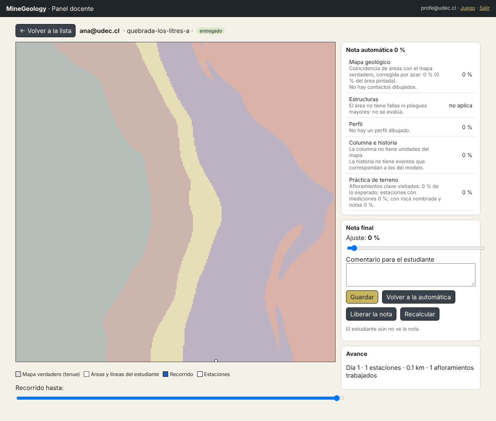

# Work package 9: accounts, graded mode and the teacher dashboard (stage B)

## What was built

- **A server** (`server/`) that runs unchanged in two places:
  - as a **Supabase Edge Function** (`server/src/edge.ts`), with Supabase's database, private storage and email sign-in;
  - as a **local server** (`server/src/local.ts`, Node), for development and the end-to-end tests, which keeps everything in a file or in memory.
  The core is one handler from a web `Request` to a `Response` (`server/src/app.ts`), with adapters for where attempts are kept (`store.ts`, `supabase.ts`), who is signing in (`auth.ts`) and where the scenarios are (`scenarios.ts`).
- **Sign-in with institutional email only** (udec.cl and its subdomains, such as alumnos.udec.cl). Teachers are listed by address and may use any address.
  - With Supabase it is the email link (magic link). The address is checked twice: by a trigger when the account is created, and by the server on every call.
  - The local server stands in for the email with a direct sign-in.
- **One attempt per student per scenario, saved on the server and resumable on any device.**
  - Every save carries the version it started from. If another device saved in between, the save is refused and that device reloads the newer copy instead of overwriting it.
  - Graded attempts are always in campaign mode (clock, costs, limited samples), with a measurement seed per student chosen by the server.
- **Graded mode keeps the answer key off the browser:**
  - **The browser gets a graded bundle** (`/bundle/<folder>/...`): terrain, cover, units, photos and the outcrop catalogue **without observations**. The manifest is rewritten with the new hash of `outcrops.json`. The practice files, `truth.json`, the lithology and orientation blocks are never served.
  - **`observe`**: what an outcrop shows comes from the server, and only to a student whose position is within 14 m of the outcrop and agrees with their last save. It is kept with the attempt, so it comes back on another device.
  - **The lab**: sample ages come from the server's answer key and are held back until the next field day. Thin-section descriptions are public anyway.
  - **The grade** is computed on the server, with the same grader code as practice mode, when the student hands in.
- **In the game**, when the site has a `server.json`:
  - the start screen asks for the institutional email, and shows who is signed in with a way out;
  - teachers also get a link to the dashboard;
  - the scenario list, the attempt and the scenario files come from the server;
  - the game saves on its own every few seconds, and logs the position every ten seconds of play for the traverse replay;
  - "Evaluar" becomes **"Entregar"** (hand in): after it, the notebook and map are closed. The student sees the grade once the teacher releases it.
  Without `server.json` the game is exactly the practice version of before (stage A).
- **Teacher dashboard** (`dashboard.html`):
  - the class list with each attempt's state, field day, stations, km walked and map, the grade and whether it is released, filtered by scenario;
  - each attempt in detail: the true map with the student's areas, lines and stations over it, and the **traverse replayed** with a slider;
  - the automatic grade part by part, an adjusted total, a comment for the student, release or withdrawal, and regrading;
  - release of all the grades of a scenario at once.
- **Supabase files:**
  - `server/supabase/migrations/0001_minegeology.sql`: the tables `attempts`, `events` and `grades`, with row-level security and no policy for the browser, so the public key reads nothing; plus the allowed domains and addresses and the trigger that enforces them;
  - `server/supabase/config.toml`;
  - the function bundle, built by `npm run build` in `server/`.
- **The graded site:** `npm run build:graded` in `game/` builds the game without any scenario file (`dist-graded/`), to host next to a `server.json`.



## Done when

"Two test students on two devices keep separate, resumable attempts; the answer key is absent from browser traffic."

`game/e2e/graded.mjs` runs against the local server with the graded build. It checks:
- Ana signs in on a laptop, works an outcrop through the server, names the rock and saves.
- Beto, on another computer, starts his own attempt with a different seed.
- Ana opens her attempt on an emulated phone: it resumes with her position, her notebook and only the one outcrop she had worked.
- The laptop, still holding the old copy, is told another device saved, instead of overwriting the phone's work.
- Ana hands in. The teacher sees both attempts (one handed in, one still in the field), opens Ana's, adjusts the grade, writes a comment and releases it. Ana then sees 62 % and the comment.
- **Answer key:** none of the 102 responses received by the students' browsers holds a formation name; no data response holds the true map or its contacts; no request asks for an answer-key file; the outcrop catalogue arrives without observations.

All 22 checks pass, with no page errors.

The server's unit tests (`server/test/app.test.ts`, 7 tests) cover:
- sign-in by domain and teacher list, and tokens that expire and cannot be forged;
- separate attempts, resuming, and refused stale saves;
- free mode cannot be smuggled into a graded attempt;
- `observe` refused from afar and kept once seen;
- the lab held back to the next day;
- no truth in what a student receives;
- the graded bundle, with no observations and none of the answer-key files;
- grading at hand-in, release, and the teacher's adjustment.
CI runs them in a new `server` job, which also builds the function and the graded site.

## Setting it up on Supabase (for Mauricio)

1. Create a project at supabase.com (the free plan is enough to start). Note its URL and its public (anon) key.
2. Database: run the migration, with the Supabase CLI (`supabase link --project-ref <ref>` then `supabase db push`), or by pasting `server/supabase/migrations/0001_minegeology.sql` in the SQL editor. To let teachers with other addresses in: `insert into allowed_emails values ('docente@gmail.com');`.
3. Scenarios: create a **private** bucket called `scenarios`. Upload, for each scenario, the folder of its **full** bake (`build/<scenario>-<variant>/`, with `truth.json` and `litho.bin`) or its practice bundle (`baked/<folder>/`), and `baked/index.json` at the top of the bucket.
4. Function: in `server/`, run `npm ci && npm run build`, then `supabase functions deploy geomapper`. Set the teachers and, if needed, other domains: `supabase secrets set TEACHER_EMAILS=mauricio@udec.cl ALLOWED_DOMAINS=udec.cl`.
5. Sign-in: in Authentication → URL configuration, add the address of the graded site as a redirect URL. In Authentication → Emails, configure an SMTP sender for production: Supabase's own sender is limited to a few emails an hour.
6. The graded site: build it with `npm run build:graded` in `game/` and host `dist-graded/` (for example on GitHub Pages, at another path or repository) with a `server.json` next to `index.html`:
   ```json
   { "kind": "supabase", "url": "https://<ref>.supabase.co", "anonKey": "<anon key>", "api": "https://<ref>.supabase.co/functions/v1/geomapper" }
   ```
   The anon key is public by design; the tables do not answer it.

To try it locally instead:

```bash
cd game && npm run build:graded
```

```bash
cd server && npm ci && npm run build && node dist/local.mjs --teachers tu@udec.cl
```

Then open http://localhost:8787.

## Choices made here

- **Every access goes through the server function**, with the service key. The browser has no direct access to the tables, which keeps the rules (and the answer key) in one place, testable without Supabase.
- **One handler, two hosts.** The same code is tested locally and runs on Supabase; only the adapters change.
- **The function asks Supabase whose token it is** (`/auth/v1/user`) instead of checking the signature itself, so it keeps working whichever key Supabase signs with.
- **Saves are whole states with a version**, not one row per action. The event log (positions, outcrops worked, hand-in) keeps what the teacher's replay needs. One row per measurement, as section 8 sketched, can come with a reporting need.
- **Lab ages are held to the next field day on the server**, as practice mode does on the client.

## Left open

- **Not deployed**: there is no Supabase project yet. Steps 1 to 6 above are for Mauricio. The Supabase adapter (`supabase.ts`) is written to Supabase's REST interfaces but has only run against the local stand-ins, not against a real project.
- **Position is reported by the browser.** The server checks that it is at the outcrop and near the last save, but a student who edits the game could still claim a position. The traverse in the dashboard shows such jumps.
- **No courses or groups** yet: the dashboard lists every attempt, filtered by scenario. Assigning variants per student and releasing per group need a course table, which comes with Canvas (work package 10).
- **No export or deletion** button for the end of the semester: it is done with SQL (the migration has an example).
- **The 3D view shows unworked outcrops in grey** in graded mode, since the browser does not know their rock until the student works them.
